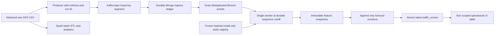

# Implemented replay architecture

All solid edges above are implemented. The 20-ping smoke executes the broker-to-store
path; F_trace.json links a real source ID through its broker delivery, snapshot, model,
history and latest record. The dashboard uses the same database/run and exposes a recent
score even when no alert crosses the threshold. Other dashboard analysis tabs retain
their historical batch/snapshot sources.

Delivery IDs are SHA-256 of `(run_id, topic, partition, offset)`. Raw identities are
unique within a run. Worker retries rebuild only events at or below the saved ingress
sequence cutoff and the monotonic simulated arrival clock. Snapshots/history are read
back after insert and become the canonical retry content. Kafka commits the processed
record's offset plus one only after durable ingress and processing. Restart drains
pending ledger records before polling Kafka. Malformed identities and conflicting raw
payloads are quarantined and remain visible in ingress.

Cloud scaling, live city feeds, online learning, traffic-signal actuation and HA remain
design work. An OS lock is a single-host coordination mechanism, not distributed fencing.
