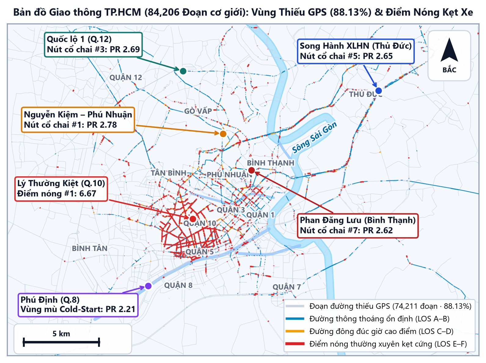
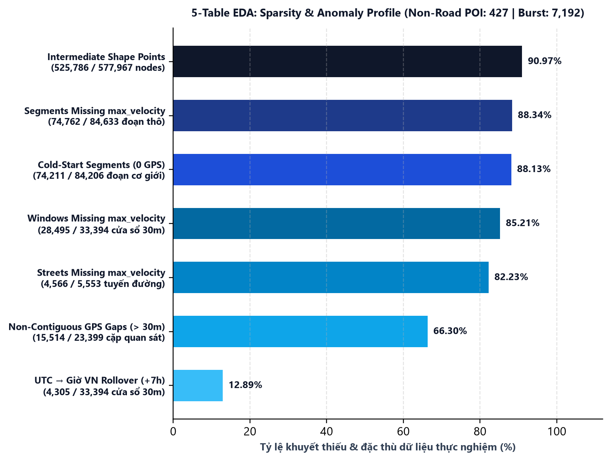
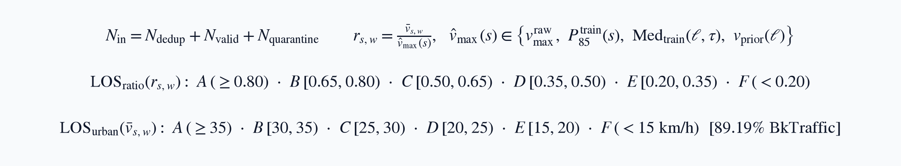
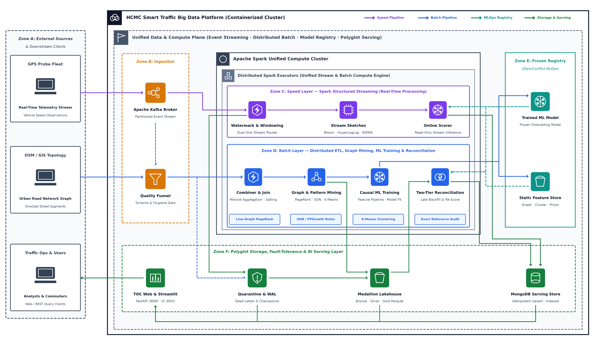
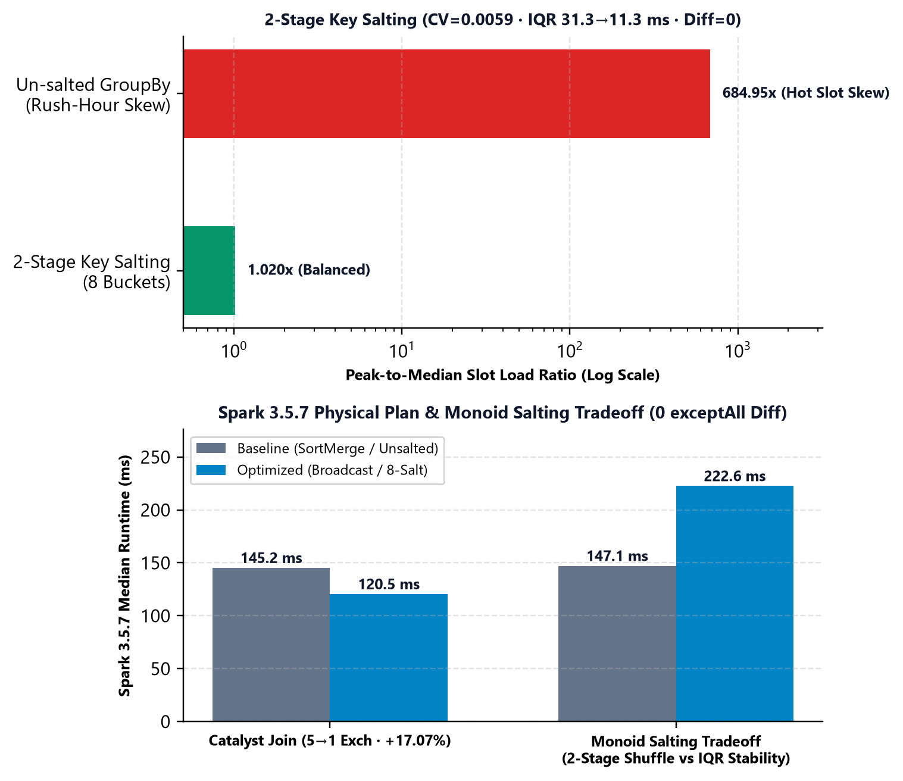
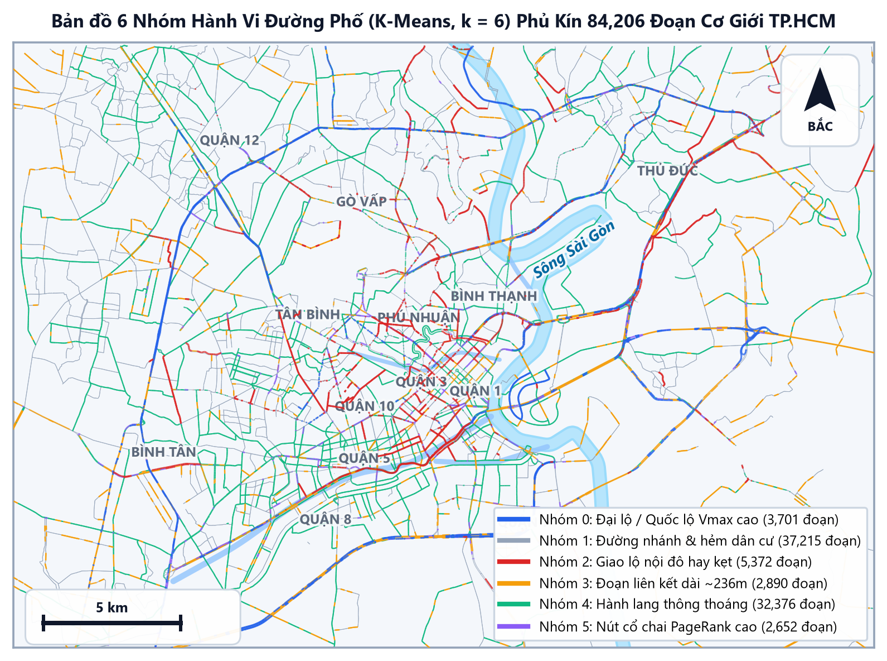
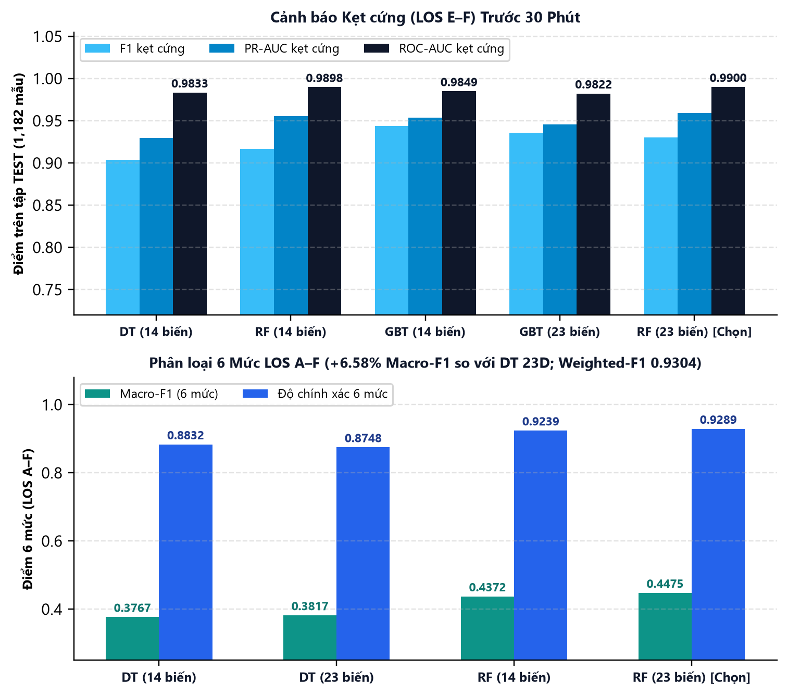
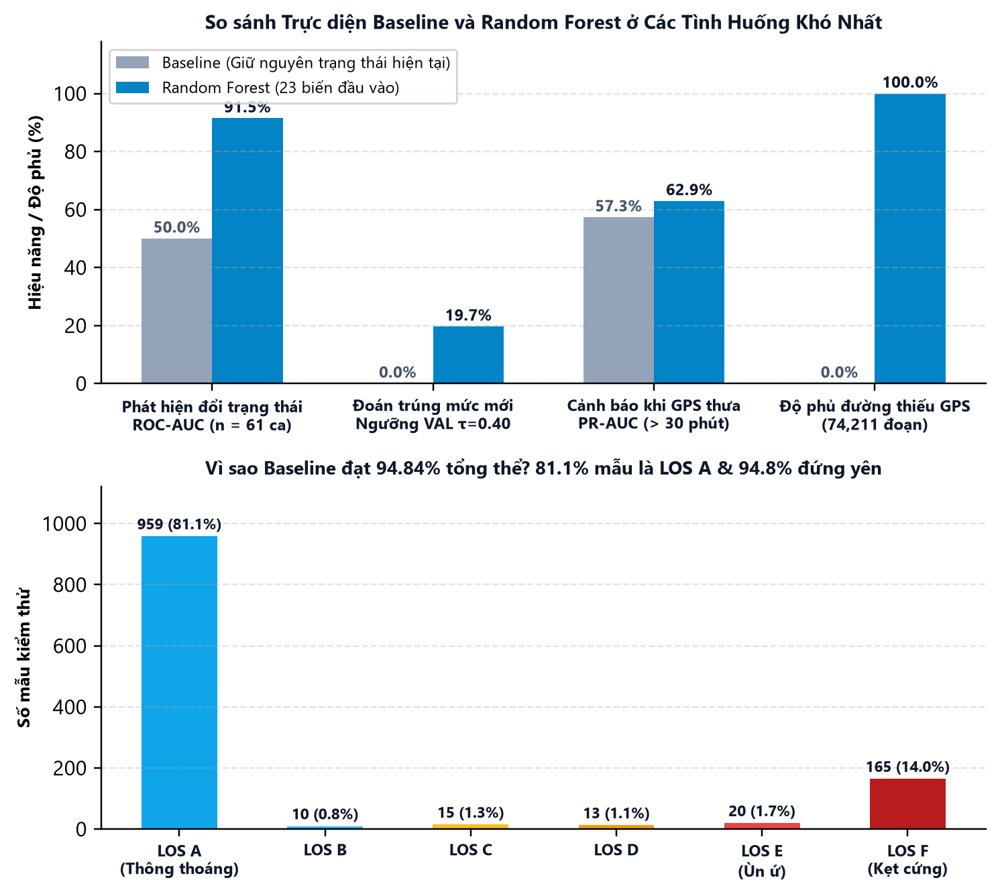
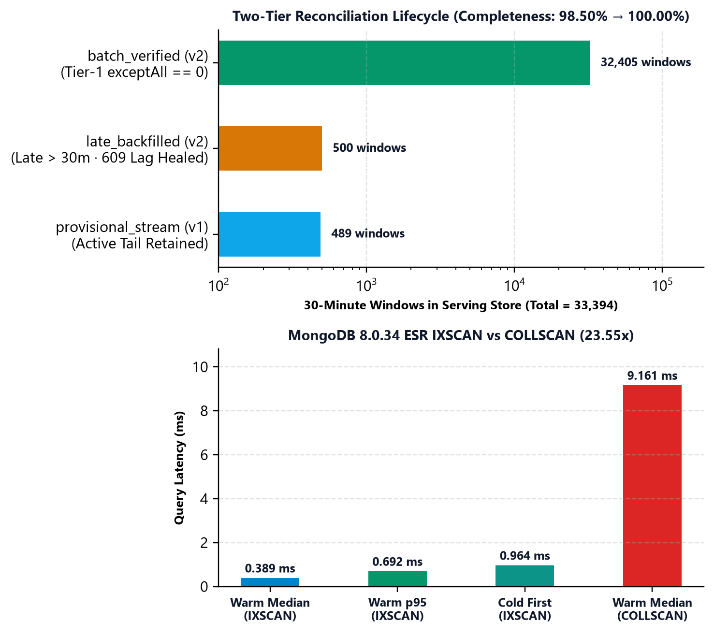

# Báo Cáo Tổng Kết Đồ Án & Đặc Tả Kỹ Thuật Chi Tiết

- **Tên đề tài:** Hệ thống Giám sát Hiện trạng & Dự báo Ùn tắc Giao thông Đô thị TP. Hồ Chí Minh (*HCMC Smart Traffic Big Data Analytics & Congestion Prediction Platform*)
- **Học phần:** `BDA501 — Big Data Analytics` (Chương trình Thạc sĩ MSE AI — FPT School of Business & Technology · `Fall 2026`)
- **Giảng viên hướng dẫn (Instructor):** **Đặng Trần Khánh**
- **Nhóm thực hiện (3 thành viên):**
  1. **Nguyễn Tạ Minh Quyền (`25MS23280`)** — *Bước 1: Làm sạch dữ liệu & Xử lý phân tán Apache Spark*
  2. **Nguyễn Thành Đạt (`25MS23306`)** — *Bước 2 & Bước 3: Đồ thị giao lộ, Phân cụm & Dự báo trước 30 phút*
  3. **Phạm Công Minh (`25MS23310`)** — *Bước 4: Luồng trực tuyến Kafka, Đối soát tin trễ, MongoDB & Giao diện điều hành*
- **Loại tài liệu:** Báo cáo tổng kết nghiệm thu cuối kỳ và hồ sơ đặc tả kỹ thuật toàn diện của hệ thống vận hành hoàn chỉnh `100%` trên hạ tầng container.

---

### Tóm Tắt Cốt Lõi (Toàn Cảnh Bài Toán & Lời Giải Trong 4 Bước — Wave 2 Verified)

> **Mục tiêu của hệ thống** là giám sát hiện trạng và dự báo trước `30 phút` nguy cơ kẹt xe trên toàn mạng lưới **`84,206` đoạn đường cơ giới một chiều** tại TP.HCM (làm sạch từ `84,633` đoạn đường thô) từ dữ liệu hành trình GPS của xe cộ (chẳng hạn lúc `07:08` sáng trên đoạn đường Lý Thường Kiệt mã `47407` tại Quận 10, một chiếc xe gửi về tín hiệu báo đang di chuyển chậm ở vận tốc `4 km/h`).
>
> Tuy nhiên, dữ liệu thực tế ngoài đường gặp **4 rào cản lớn**:
> 1. **Thiếu hụt thông tin:** **`88.13%`** đoạn đường cơ giới (`74,211 / 84,206` đoạn, chủ yếu là đường nhánh và hẻm dân cư) không có xe gửi GPS về, và `88.34%` đoạn đường bị thiếu thông tin tốc độ tối đa cho phép;
> 2. **Đứt quãng thời gian & Đợt burst tổng hợp:** Xe gửi tín hiệu không đều, lúc cách nhau `30 phút`, lúc ngắt quãng nhiều giờ/ngày, đồng thời xuất hiện `7,192` cửa sổ burst đồng loạt (`2020-08-02 23:30` & `2020-08-03 00:00`) làm nhiễu phân bố huấn luyện;
> 3. **Nhiễu đường truyền:** Bản tin gửi về theo thời gian thực thường bị trùng lặp hoặc đến trễ quá hạn (`Watermark 30m`).
>
> Để giải quyết trọn vẹn, hệ thống vận hành qua **4 bước nối tiếp nhau**:
> - **Bước 1 – Chuẩn hóa bức tranh hiện trạng (Spark Batch ETL):** Làm sạch `90,938` bản tin GPS thô thành **`90,787` bản tin cơ giới hợp lệ** (cách ly `151` bản tin rơi vào `427` đoạn phi đường bộ), ước lượng tốc độ tối đa trên `TRAIN` hữu cơ, và gom bằng Pure 5-Tuple Monoid thành **`33,394` cửa sổ 30 phút UTC** (`BkTraffic urban 5 km/h LOS` khớp **`89.19%`** bảng tham chiếu `train.csv`; `0` sai lệch so với `baseline.py`).
> - **Bước 2 – Lấp đầy "vùng mù" bằng cấu trúc bản đồ (Đồ thị & Phân cụm):** Tỉa bỏ `90.97%` nút uốn cong/mồ côi (`525,786` nút), dựng đồ thị đường bộ **đã loại cung U-turn** (`92,453` cạnh, `314` đoạn cụt), tính `PageRank` (`#1`: `21969 — Nguyễn Kiệm`, `PR = 2.7799`), khai phá luật kết hợp trên `TRAIN` hữu cơ, và gom nhóm `K-Means` ($k=6$) trên `3,609` đoạn hữu cơ để phủ kín `74,211` đoạn thiếu GPS (`88.13%`).
> - **Bước 3 – Lọc burst & Dự báo trung thực `+30 phút` (Machine Learning):** Loại `3,596` cặp burst khi huấn luyện (`1,885` cặp `TRAIN` hữu cơ / `1,167` `VAL` / `1,182` `TEST`, `7,885` cặp đúng `+30m`), huấn luyện sạch không dùng `sample_weight` nhân tạo (`class_weight` lũy thừa `0.65`) cho `Random Forest (23D)` đạt **`ROC-AUC = 0.9900`**, **`PR-AUC = 0.9595`**, **`Severe F1 = 0.9301`**.
> - **Bước 4 – Cảnh báo trực tuyến & Tự động bù dữ liệu trễ (Kafka, MongoDB & Dual Web UI):** Chấm điểm trực tuyến qua `Kafka 4.1` + `32 KiB RotatingBloom` + `1 KiB 64-bit HLL` + `EWMA`, `WAL = 73.7 KB`, phục vụ dưới `1 ms` trên `MongoDB 8.0` (**`warm median = 0.389 ms / p95 = 0.692 ms`**) qua **Web TOC `ReactJS + FastAPI (:8000)`** và **`Streamlit (:8501)`**, đồng thời tự động bù `500` cửa sổ trễ và hàn gắn `609` cửa sổ hạ lưu để đạt độ đầy đủ **`100.0%`**.

---

## Chương 1. Câu Chuyện Thực Tế Từ Dòng Tín Hiệu GPS, Coupled Sub-Problems (P1–P4), Operational Use Cases (UC-1–UC-6) & System Boundary

### 1.1. Bối Cảnh Bài Toán Điều Hành Giao Thông TP.HCM, Dòng Dữ Liệu Thực Tế & Vai Trò Mẫu Chuẩn Proof-of-Scale

Tại siêu đô thị TP. Hồ Chí Minh, mật độ phương tiện rất lớn lưu thông trên mạng lưới hàng chục nghìn đoạn đường và ngã tư đan xen chặt chẽ (từ cửa ngõ sân bay Tân Sơn Nhất, đầu mối trung tâm Bến Thành – Quận 1, trục xuyên tâm Lý Thường Kiệt – Quận 10 đến hành lang Đông Bắc Thủ Đức và vành đai Quốc lộ 1). Chỉ một điểm ùn ứ cục bộ vào giờ cao điểm cũng nhanh chóng lan truyền thành kẹt xe dây chuyền. Trong khi đó, công tác điều tiết hiện nay còn gặp **ba khoảng trống thực tiễn**: **(1)** hệ thống camera CCTV và vòng từ cố định có chi phí đầu tư/bảo trì cao nên chỉ đặt được ở một số giao lộ lớn, còn nguồn định vị GPS hành trình lại lệch về đại lộ, bỏ trống phần lớn đường nhánh (*vùng mù quan trắc*) và thường xuyên ngắt quãng, trễ tin; **(2)** các bảng giám sát hiện hữu chỉ phản ánh nơi **đang kẹt ở hiện tại**, thiếu cảnh báo sớm trước `30 phút` nơi **sắp chuyển sang kẹt cứng** để điều chỉnh đèn và phân luồng chủ động; và **(3)** công tác trực ban xử lý sự vụ tức thời tại Trung tâm Điều hành (`TOC`) vẫn tách rời khỏi bài toán phân tích nút cổ chai quy hoạch dài hạn của `Sở GTVT`.

Để thấy rõ thách thức từ dữ liệu thực địa trước khi đi vào giải pháp, hãy nhìn vào một dòng dữ liệu gốc trong bảng `segment_status.csv`:
- Vào lúc **`07:08:28` sáng giờ Việt Nam** ngày `03/08/2020` (bản ghi mã `15281`), một chiếc xe đi ngang qua **đoạn đường Lý Thường Kiệt số `47407`** (dài `16m` tại Quận 10) gửi về vận tốc tức thời chỉ **`4 km/h`**; hoặc lúc **`11:30` trưa** tại **Công Trường Quốc Tế (đoạn `21064`, Quận 3)**, xe báo vận tốc **`12 km/h`**.

Để biến hàng chục nghìn con số vận tốc rời rạc như vậy thành bức tranh điều hành thống nhất trên toàn mạng lưới **`84,206` đoạn đường cơ giới một chiều** (`84,633` đoạn thô sau lọc `427` đoạn phi đường bộ), hệ thống đối chiếu theo **6 mức phục vụ giao thông (`Level of Service` — `LOS` từ `A` đến `F`)** theo chuẩn **BkTraffic Urban 5 km/h** (`derive_urban_los`, khớp **`89.19%`** nhãn gốc `train.csv`), đồng thời tách riêng hàm chuẩn hóa tỷ lệ `derive_los` (`0.80/0.65/0.50/0.35/0.20`):
- **Mức `LOS A` và `LOS B` (vận tốc đạt từ `65%` tốc độ tối đa hoặc `≥ 30 km/h` đô thị):** Đường thông thoáng, xe cộ lưu thông tự do.
- **Mức `LOS C` và `LOS D` (`35%–65%` tốc độ tối đa hoặc `20–30 km/h`):** Đường đông đúc ổn định vào khung giờ cao điểm.
- **Mức `LOS E` và `LOS F` (`< 35%` tốc độ tối đa hoặc `< 20 km/h`, riêng `LOS F < 15 km/h` hoặc dừng hẳn):** Đường ùn ứ nghiêm trọng đến kẹt cứng tê liệt.



*Hình 1.1. Bản đồ giao thông TP.HCM tái tạo trên nền sông Sài Gòn, kênh Tàu Hủ – Bến Nghé và các quận trung tâm: phần nền xám nhạt là **`74,211` đoạn đường nhánh không có xe gửi GPS (`88.13% Cold-Start`)**, các trục đỏ là điểm nóng thường xuyên kẹt cứng (Lý Thường Kiệt, Trương Định, Nguyễn Kiệm, Quốc lộ 1, Hoàng Văn Thụ).*

> **Vai trò mẫu chuẩn kiểm chứng quy mô (`Proof-of-Scale` — Tại sao xây dựng kiến trúc `Spark + Kafka` trên bộ dữ liệu mẫu `~38.5 MB`?):**
> Năm bảng công khai của bộ dữ liệu giao thông TP.HCM trên Kaggle có tổng dung lượng **`38.50 MB`** (riêng bảng vận tốc `segment_status.csv` nặng **`3.58 MB`** với `90,938` bản tin GPS). Nếu chỉ tính toán một lần trên tệp tĩnh này, thư viện `Pandas` trên máy cá nhân chỉ mất vài chục mili-giây. Tuy nhiên, trong khuôn khổ môn học `BDA501 — Big Data Analytics`, bộ dữ liệu này đóng vai trò **mẫu chuẩn kiểm chứng quy mô (`Proof-of-Scale`)**:
> 1. **Quy mô thực tế toàn đô thị TP.HCM:** Khi kết nối luồng định vị thực tế từ hơn `1` triệu xe buýt, taxi, xe công nghệ và xe tải phát tín hiệu mỗi `5–10` giây, hệ thống sẽ tiếp nhận **`8–17` tỷ bản tin/ngày (`~1.5–3.0 TB/ngày`)**. Ở quy mô đó, hiện tượng lệch tải giờ cao điểm (gấp **`684.95` lần** trung vị) và bộ nhớ lọc bản tin trùng không giới hạn sẽ làm tràn RAM máy đơn.
> 2. **Kiểm chứng sai số toán học bằng `0.0` trước khi nhân rộng:** Thử nghiệm kiến trúc phân tán trên mẫu chuẩn `90,787` bản tin sạch (`90,938` thô) cho phép đối chiếu từng con số với bộ đối chứng độc lập `baseline.py` để chứng minh **sai số bằng `0.0`** trước khi mở rộng ngang ra cụm máy chủ lớn.

### 1.2. Sự Liên Kết Nhân Quả Giữa Bốn Bài Toán Trong Cùng Một Hệ Thống (Coupled Sub-Problems P1 → P4)

Bốn bài toán `P1`, `P2`, `P3`, `P4` là **bốn mắt xích nối tiếp nhau trong một dây chuyền thống nhất**: kết quả chuẩn hóa của `P1` nuôi dữ liệu cho `P2`; đặc trưng nút cổ chai và nhóm đường phố ở `P2` truyền thẳng làm biến đầu vào cho mô hình dự báo ở `P3`; và mô hình `P3` được đưa vào chấm điểm trực tuyến kết hợp theo dõi điểm nóng ở `P4`:

| Mắt xích Hệ thống | Câu hỏi Thực tiễn Cần Giải quyết | Dữ liệu Đầu vào Thực tế | Kết quả Sinh ra & Mối Nối Sang Bước Sau |
|---|---|---|---|
| **`P1: Descriptive` (Batch Layer)** | **Hiện tại và trong lịch sử, đoạn đường nào đang thông thoáng hay kẹt cứng?** | `90,938` bản tin GPS thô (`90,787` hợp lệ sau lọc `427` đoạn phi đường bộ); `88.34%` đoạn đường thiếu tốc độ tối đa. | **`33,394` cửa sổ `30 phút UTC`** gắn mức `LOS A–F` (`89.19%` khớp `BkTraffic`), Pure Monoid sai số `0.0` so với `baseline.py`. |
| **`P2: Diagnostic` (Graph & Clustering)** | **Làm sao hiểu các nút cổ chai và `88.13%` đoạn đường nhánh `Cold-Start` không có xe gửi GPS?** | Bản đồ giao lộ **`84,206` đoạn cơ giới sạch** (`92,453` cạnh bỏ U-turn, `314` đoạn cụt) và `3,609` đoạn `TRAIN` hữu cơ. | Nút cổ chai `PageRank` (`#1`: `21969 Nguyễn Kiệm`), `12+14` luật trên `TRAIN` hữu cơ và `6` cụm `7D K-Means` phủ `100%` mạng lưới cho `P3`. |
| **`P3: Predictive` (+30m Forecasting)** | **Đúng 30 phút nữa, đoạn đường nào sẽ chuyển sang kẹt cứng?** | `7,885` cặp đúng `+30m`; lọc bỏ `3,596` cặp burst giữ **`1,885` `TRAIN` hữu cơ / `1,167` `VAL` / `1,182` `TEST`**. | Mô hình sạch `Random Forest (23D)` không `sample_weight` nhân tạo (**`ROC-AUC = 0.9900`**, **`PR-AUC = 0.9595`**, **`Severe F1 = 0.9301`**), bàn giao cho `P4`. |
| **`P4: Prescriptive` (Speed & Serving Layer)** | **Làm sao vừa cảnh báo dưới `1 ms` trên màn hình trực ban, vừa không mất tin đến trễ?** | Luồng bản tin GPS (`33,727` sự kiện cửa sổ / `91,694` pings thô) lẫn `~1%` tin trùng và `~5%` tin trễ. | `32 KiB RotatingBloom` + `1 KiB 64-bit HLL`, `MongoDB IXSCAN` **`0.389 / 0.692 ms` (`23.55x` vs COLLSCAN)**, bù `500` cửa sổ trễ và hàn gắn `609` cửa sổ hạ lưu. |

### 1.3. Sáu Kịch Bản Vận Hành Thực Tế (Operational Use Cases UC-1–UC-6)

| Use Case | Người Sử dụng (Actor) | Thông tin Nhận được trên Màn hình | Quyết định Xử lý Ngoài Đời thực |
|---|---|---|---|
| **`UC-1` — EWMA Hotspot Alerting** | Cán bộ Trung tâm Điều hành (`TOC`) | Danh sách `25` đoạn đường đang kẹt cứng liên tiếp nhiều khung giờ (`#1`: `47407` Lý Thường Kiệt `6.6652`, `#2`: `21263` Trương Định `6.6635`). | Phát cảnh báo sớm lên bảng điện tử ngoài đường và điều lực lượng cảnh sát giao thông ra giải tỏa tại nút giao. |
| **`UC-2` — Proactive Signal Priority** | Kỹ sư Tín hiệu Đèn giao thông | Danh sách các trục đại lộ cấp `1–2` có xác suất kẹt cứng `≥ 70%` trong `30 phút` tới (`1,202` cửa sổ, `IXSCAN warm_median = 0.389 ms`, `p95 = 0.692 ms`). | Chủ động kéo dài pha đèn xanh cho hướng trục chính trước khi dòng xe kịp dồn ứ khóa chặt ngã tư. |
| **`UC-3` — Bottleneck & Sensor Planning** | Chuyên viên Quy hoạch (`Sở GTVT`) | Bản đồ xếp hạng nút cổ chai `Line-Graph PageRank` (`#1`: `21969` Nguyễn Kiệm `2.7799`, `#2`: `37345` Cầu vượt Gò Dưa `2.7196`, `#3`: `34723` Quốc lộ 1 `2.6894`) ngay cả nơi thiếu GPS. | Xác định đúng vị trí trọng yếu để ưu tiên lắp mới camera giám sát và biển báo phân luồng tải trọng theo giờ. |
| **`UC-4` — Spillover Detour Routing** | Ứng dụng Bản đồ & Dẫn đường | Cảnh báo các cặp đường thường kẹt đồng thời (`Nguyễn Thị Minh Khai ↔ Cống Quỳnh`, `Lift = 15.23`) hoặc lan sau `30 phút` (`Lê Quang Định → Trần Quang Khải`, `Lift = 24.0`). | Gợi ý người lái xe rẽ sang lộ trình thay thế từ các ngã tư phía xa trước khi đi vào hành lang đang ùn tắc. |
| **`UC-5` — Cluster-Based Patrol Dispatch** | Đội Tuần tra & Điều tiết Giao thông | Bản đồ chia toàn bộ `84,206` đoạn đường thành `6` cụm hành vi `7D K-Means` (`Cluster 2` có tỷ lệ kẹt `42.01%` trên `10,621` cửa sổ; `Cluster 5` có `PageRank` cao `1.61`). | Tập trung lực lượng chốt trực đúng nhóm giao lộ nội đô nghẽn mãn tính vào giờ cao điểm thay vì rải đều. |
| **`UC-6` — Late-Data Reconciliation** | Kỹ sư Dữ liệu & Vận hành hệ thống | Báo cáo `Two-Tier Reconciliation` cuối ngày: `tier1_exceptAll_diff = 0`, bù `500` cửa sổ trễ (`226` khung giờ), hàn gắn `609` cửa sổ hạ lưu, chấm lại `384` (`185` đổi xác suất). | Đảm bảo `100%` số liệu báo cáo tổng kết cuối ngày của Sở GTVT và kho dữ liệu huấn luyện đạt độ chính xác tuyệt đối. |

### 1.4. System Boundary (2 Nguồn Dữ Liệu Đầu Vào → 4 Nhóm Kết Quả Đầu Ra)

- **Hai nguồn dữ liệu đầu vào thực tế (`External Inputs`):**
  1. **Luồng bản tin vận tốc GPS (`producer.py`, `seed = 42`):** Phát `90,787` bản tin GPS cơ giới hợp lệ (`90,938` thô từ `segment_status.csv`) vào `Apache Kafka 4.1.0 KRaft`, tái hiện môi trường mạng di động có `~1%` bản tin gửi trùng và `~5%` bản tin đến trễ.
  2. **Bản đồ số đường bộ TP.HCM (`GIS Topology`):** Gồm 3 bảng địa lý `nodes.csv` (`577,967` điểm tọa độ $\to$ `52,181` giao lộ hoạt động), `streets.csv` (`5,553` tuyến đường) và `segments.csv` (`84,633` đoạn thô $\to$ `84,206` đoạn cơ giới sạch). Riêng bảng `train.csv` (`33,441` dòng) chỉ dùng làm **bảng đối chứng tham chiếu độc lập** (`89.19%` khớp `BkTraffic urban 5 km/h LOS` và `100.0%` khóa `33,394` cửa sổ cơ giới).
- **Bốn nhóm kết quả đầu ra chính thức (`System Outputs`):**
  1. **`Medallion Lakehouse` (`data/lakehouse/`):** Gồm `bronze_raw_events/events.parquet` (`90,787` pings), `stream_replay_windows/replay.parquet` (`33,727` cửa sổ), `silver_cleaned_windows/windows.parquet` (`33,394` × `86`), `curated_gold/year_month=*` (`10` phân vùng tháng đọc sạch bởi cả PyArrow và Spark 3.5.7), cùng bảng `data/dataset.csv` (`33,394` dòng × `60` cột).
  2. **`Frozen Model & Static Feature Registry`:** Gồm `model.joblib` (`rf_full_23d_v3`), `vmax_lookup.json` và `segment_static_features.parquet` phủ đủ `84,206` đoạn cơ giới.
  3. **`Quarantine & WAL Checkpoints`:** Lưu `580` bản ghi GIS cách ly (`quarantine_events.parquet`) và trạng thái hồi phục `WAL` (`73.7 KB`).
  4. **`MongoDB 8.0.34 Serving Store`, `Web TOC (:8000)` & `Streamlit (:8501)`:** Phục vụ `33,394` bản ghi trạng thái và dự báo với độ trễ **`IXSCAN warm median = 0.389 ms / p95 = 0.692 ms`**, làm mới trực tiếp trên trình duyệt.

*Hình 1.2. Sơ đồ System Boundary: 2 nguồn dữ liệu thực tế đi qua Unified Pipeline (P1 → P4) tạo ra 4 nhóm kết quả phục vụ điều hành trực tuyến và phân tích lịch sử.*

### 1.5. Tổng Quan Nghiên Cứu Quản Lý – Dự Báo Giao Thông Đô Thị (Literature Review) & Khoảng Trống Thực Tiễn

Theo quy trình nghiên cứu thuận chiều (**Xác định bài toán thực tế → Khảo sát giải pháp hiện có → Xác định khoảng trống → Đề xuất nền tảng tích hợp → Thực nghiệm kiểm chứng**), nhóm khảo sát bốn hướng tiếp cận chính trong quản lý và dự báo giao thông đô thị:

| Hướng Tiếp Cận Trong Thực Tế & Học Thuật | Hệ Thống Điển Hình & Công Trình Tiêu Biểu | Đóng Góp Trong Quản Lý Giao Thông | Hạn Chế Khi Áp Dụng Cho Đô Thị Như TP.HCM |
|---|---|---|---|
| **1. Quan trắc Hạ tầng Cố định & Đèn Thích ứng (`Fixed-Sensor ITS`)** | Cảm biến vòng từ, Camera CCTV; hệ thống đèn `SCATS` (*Sims & Dobinson, 1980*), `SCOOT` (*Hunt et al., 1981*). | Đo đạc lưu lượng liên tục, chính xác cao tại các nút giao có lắp thiết bị để điều chỉnh chu kỳ đèn cục bộ. | Chi phí đầu tư và bảo trì rất lớn; chỉ bao phủ số ít trục chính, để trống gần `90%` mạng lưới đường nhánh và khu dân cư (*vùng mù quan trắc*). |
| **2. Giám sát Từ Dữ liệu Hành trình (`Floating Car / Probe GPS`)** | Định vị GPS từ xe buýt, taxi, bản đồ số (*Herrera et al., 2010; Zheng, 2015*). | Mở rộng độ phủ giám sát diện rộng không cần đào đường lắp cảm biến, phản ánh trực tiếp vận tốc dòng xe. | Phân bố lệch mạnh về đại lộ, tín hiệu ngắt quãng dài theo thời gian, khuyết thông tin tốc độ chuẩn và mới dừng ở bản đồ hiện trạng. |
| **3. Nghiên cứu Dự báo Ùn tắc Ngắn hạn (`Short-Term Forecasting`)** | Chuỗi thời gian `ARIMA` / Quán tính (*Vlahogianni et al., 2014*); mạng đồ thị sâu `DCRNN`, `Graph WaveNet` (*Li et al., 2018*). | Dự báo vận tốc hoặc mức độ ùn tắc trước `15–60 phút` dựa trên tương quan không gian – thời gian. | Phần lớn thử nghiệm trên cao tốc có cảm biến dày đặc, liên tục (`PeMS`, `METR-LA`); suy giảm mạnh khi dữ liệu đô thị thưa (**`88.13%` đoạn trống chuỗi GPS**) và đứt quãng. |
| **4. Nền tảng Hỗ trợ Quyết định Điều hành (`Urban Traffic DSS`)** | Trung tâm điều hành `TOC` & nền tảng dữ liệu lớn đô thị (*Lv et al., 2015; Amini et al., 2017*). | Hợp nhất lưu trữ lịch sử phục vụ quy hoạch với bảng điều khiển giám sát trực tuyến cho điều hành viên. | Mô hình dự báo học thuật thường tách rời khỏi luồng vận hành thực tế (bản tin GPS di động trễ/trùng); thiếu sự gắn kết giữa cảnh báo tức thời và quy hoạch điểm nghẽn dài hạn. |

> **Khoảng trống nghiên cứu & Lý do cần nền tảng tích hợp `HCMC Smart Traffic`:** Các công trình dự báo ngắn hạn thường giả định dữ liệu cảm biến sạch và liên tục, trong khi hệ thống giám sát đô thị thực tế lại thiếu dự báo sớm `+30 phút` và bỏ trống vùng đường nhánh không có GPS. Việc triển khai rời rạc từng công nghệ đơn lẻ không giải quyết được bài toán: một mô hình học máy độc lập không thể tự làm sạch luồng GPS di động nhiễu/đến trễ, không thể suy diễn trạng thái cho **`74,211` đoạn đường vùng mù** nếu tách rời phân tích cấu trúc đồ thị mạng lưới đường, và không thể phục vụ đồng thời cả trực ban `TOC` lẫn quy hoạch `Sở GTVT`. Đây chính là cơ sở khoa học để đồ án đề xuất kiến trúc nền tảng tích hợp ở các chương tiếp theo.

---

## Chương 2. P1A — Khảo Sát 5 Bảng Dữ Liệu Gốc (EDA), 10 Edge Cases Thực Nghiệm & Ordered Quality Funnel

### 2.1. Kiểm Kê Chi Tiết Năm Bảng Dữ Liệu Nguồn (`raw_data/` · Giao thông TP.HCM)

| Bảng Dữ liệu | Số Bản ghi | Số Cột | Dung lượng | Khóa Chính / Khóa Ngoại | Đặc điểm Phân bố Khi Khảo sát Thực tế |
|---|---:|---:|---:|---|---|
| **`nodes.csv`** | `577,967` | `3` | `19.44 MB` | PK: `_id` · Cột: `_id, long, lat` | Có tới **`525,786` nút (`90.97%`) là `intermediate shape points` / nút mồ côi** trên OpenStreetMap; giữ đúng **`52,181` giao lộ thực sự** của mạng đường cơ giới. |
| **`streets.csv`** | `5,553` | `5` | `0.20 MB` | PK: `_id` · Cột: `_id, level, max_velocity, name, type` | Cấp đường từ `1` đến `4`; **`82.23%` (`4,566` tuyến) khuyết tốc độ tối đa**; tồn tại `695` tên đường thô lệch chuẩn dấu tiếng Việt cần gộp về **`641` tên chuẩn `Unicode NFC`** (`54` biến thể gộp). |
| **`segments.csv`** | `84,633` | `11` | `10.29 MB` | PK: `_id`; FK: `s_node_id, e_node_id, street_id` | **`88.34%` (`74,762` đoạn) thiếu tốc độ tối đa**; **`154` đoạn chiều dài `≤ 0m`**; **`427` đoạn phi đường cơ giới** (`580` đoạn lỗi cách ly). Mạng cơ giới sạch còn **`84,206` đoạn**: `9,995` (`11.87%`) có GPS, **`74,211` đoạn (`88.13% Cold-Start`) không có dữ liệu GPS**. |
| **`segment_status.csv`** | `90,938` | `4` | `3.58 MB` | PK: `_id`; FK: `segment_id` · Cột: `updated_at, velocity` | Chuỗi bản tin GPS theo giờ `UTC` (`07/2020–04/2021`); cách ly **`151` bản tin rơi ngoài đường cơ giới**, còn **`90,787` bản tin hợp lệ**; giờ cao điểm lệch tải (`Data Skew`) lên tới **`684.95` lần** trung vị. |
| **`train.csv`** | `33,441` | `18` | `4.99 MB` | Khóa cửa sổ `(segment_id, date, period)` kèm nhãn `LOS` | *Bảng đối chứng tham chiếu* · Khớp `100.0%` khóa của **`33,394` cửa sổ cơ giới** (chênh đúng `47` cửa sổ phi đường bộ); `85.21%` (`28,495` dòng) thiếu `max_velocity`; `631` dòng tên `Phường/Quận`; **`4,305` cửa sổ cơ giới (`12.89%`)** đổi ngày khi chuyển `UTC → ICT`. |



*Hình 2.1. Tỷ lệ khuyết thiếu tốc độ tối đa, intermediate shape points, đoạn đường Cold-Start thiếu GPS và tín hiệu ngắt quãng trên 5 bảng dữ liệu gốc.*

### 2.2. Danh Mục 10 Edge Cases Thực Nghiệm & Cơ Chế Phòng Vệ Kỹ Thuật (`EC-1–EC-10`)

| Edge Case | Hiện tượng Dữ liệu Thực tế | Quy mô Ghi nhận Định lượng | Giải pháp Kỹ thuật Đã Triển khai & Kiểm chứng |
|---|---|---|---|
| **`EC-1`** | Thiếu thông tin tốc độ tối đa diện rộng (`Missing max_velocity`) | `28,495 / 33,441` cửa sổ (`85.21%`) & `74,762 / 84,633` đoạn (`88.34%`) | **Train-Only 3-Tier Imputation (`vmax_lookup.json`):** Giữ tốc độ gốc (`4,946` cửa sổ) → Phân vị `P85` trên `TRAIN` hữu cơ (`9,376` cửa sổ) → Trung vị `(level, street_type)` (`17,693` cửa sổ) → Chuẩn đô thị `{80, 60, 50, 40}` (`1,379` cửa sổ). |
| **`EC-2`** | Đoạn đường chiều dài `≤ 0m` hoặc thuộc lối đi bộ (`Non-road OSM tags`) | `154` đoạn `≤ 0m` & `427` đoạn phi cơ giới (`580` đoạn lỗi cách ly) | Lưu vết vào `quarantine_events.parquet` theo lỗi đầu tiên; điền trung vị `27.0m`; loại `427` đoạn phi cơ giới & `151` bản tin GPS tương ứng ngay từ đầu (`84,206` đoạn, `90,787` pings, `33,394` cửa sổ). |
| **`EC-3`** | Tên đường chứa nhãn `Phường/Quận` & lệch chuẩn `Unicode NFD/NFC` | `631` cửa sổ `Phường/Quận` & **`2,247` cửa sổ** biến thể dấu/khoảng trắng | Chuẩn hóa dấu `Unicode NFC`, đồng nhất `Ð → Đ` (`695` tên thô gộp về **`641` tên chuẩn**, hợp nhất **`54` biến thể**); loại bỏ nhãn `Phường/Quận` khỏi giỏ `SON / FPGrowth`. |
| **`EC-4`** | Đổi ngày qua nửa đêm khi chuyển giờ `UTC` sang giờ Việt Nam (`UTC+7`) | **`4,305 / 33,394` cửa sổ (`12.89%`)** rơi vào khung `17:00–23:30 UTC` | Giữ nguyên ngày `UTC` làm khóa chuẩn, đồng thời tính chính xác giờ Việt Nam `vn_hour` và cộng `+1 ngày` cho `ict_date` khi `hour_utc ≥ 17`. |
| **`EC-5`** | Tín hiệu GPS ngắt quãng & Đợt burst tổng hợp tháng 08/2020 | `7,885` cặp chuẩn `+30m`; **`7,192` cửa sổ burst** (`2020-08-02 23:30` & `08-03 00:00`, mỗi slot `3,609` thô / `3,596` cơ giới) | Ghép nhãn chính xác `(segment_id, slot_ts + 30m)` và loại **`3,596` cặp burst** khi huấn luyện ML (`1,885` `TRAIN` hữu cơ / `1,167` `VAL` / `1,182` `TEST`). |
| **`EC-6`** | `88.13%` đoạn đường nhánh không có xe gửi GPS (`Cold-Start Segments`) | **`74,211 / 84,206` đoạn cơ giới** không có bản tin GPS nào | Xây dựng kho tĩnh `segment_static_features.parquet` phủ kín **`84,206` đoạn** (`100%`) nhờ `PageRank`, bậc vào/ra và tâm cụm `7D K-Means`. |
| **`EC-7`** | Điểm uốn cong trung gian (`Shape Points`), `U-turn` & `Dangling Sinks` | **`525,786 / 577,967` nút (`90.97%`)** & **`314` `Dangling Nodes`** | Lọc bỏ `525,786` nút phụ và loại cung quay đầu `U-turn` trên đoạn hai chiều (`92,453` cạnh); chia đều xác suất `314` đoạn cụt trong `PageRank`. |
| **`EC-8`** | Lệch tải giờ cao điểm (`Data Skew`) & bẫy trung bình từng phần | Lệch tải **`684.95x`**; trung bình từng phần gây sai số `11.11 km/h` | Gộp song song bằng **Pure 5-Tuple Monoid** + `8` salt buckets kéo lệch tải giỏ cao điểm về **`1.0197x`** (`salted_partition_skew_ratio = 1.0123x`, `CV = 0.0059`), sai số `0.0`. |
| **`EC-9`** | Bản tin mạng di động gửi trùng (`~1%`) và đến trễ (`> 30m Watermark`) | `333` cửa sổ trùng lặp & **`500` cửa sổ trễ** trải trên **`226` khung giờ** | Chặn `333/333` tin trùng bằng `32.0 KiB Bloom` (`FPR = 0.611%`); cuối ngày bù `500` cửa sổ trễ, hàn gắn **`609` cửa sổ hạ lưu** và chấm lại **`384` cửa sổ** (`185` đổi xác suất). |
| **`EC-10`** | Sập tiến trình luồng đột ngột & tin cũ đến muộn ghi đè (`Stale Overwrite`) | Ngắt cưỡng bức giữa chừng hoặc bản ghi `v1` đến muộn sau đối soát | Hồi phục chính xác từ **`WAL 73.7 KB`** (`0` nhân đôi); atomic **`$status_version` pipeline guard** trong `MongoDB 8.0` chặn `25/25` bản tin `v1` cũ ghi đè `v2`. |

### 2.3. Ordered Quality Funnel (Bảo Toàn 100% Quân Số Bản Ghi)

Toàn bộ dữ liệu thô đi vào hệ thống đều được ép kiểu an toàn `try_cast` dưới chế độ `spark.sql.ansi.enabled = true`. Sáu quy tắc kiểm định thực thi theo thứ tự (`R1` → `R6`) sao cho mỗi bản ghi lỗi chỉ nhận đúng một mã lỗi đầu tiên:

| Thứ tự | Mã Quy tắc Kiểm định | Nguồn Kiểm tra | Điều kiện Phát hiện (`ANSI try_cast`) | Quy mô Ghi nhận (`quarantine_summary.csv`) | Hành động Chuẩn hóa |
|---:|---|---|---|---:|---|
| `1` | **`R1_NONPOSITIVE_SEGMENT_LENGTH`** | `segments.csv / train` | `try_cast(length AS DOUBLE) <= 0 OR NULL` | `154` đoạn (`154` first-failing, `57` cửa sổ) | Lưu vết lỗi chiều dài và điền trung vị `27.0m`. |
| `2` | **`R2_NON_ROAD_OSM_TAG`** | `segments.csv` | `street_type IN ('service','footway','path','steps','pedestrian','track')` | `427` đoạn (`426` first-failing, `47` cửa sổ) | Cách ly và loại khỏi đồ thị + ETL (`84,633 → 84,206` đoạn cơ giới). |
| `3` | **`R3_ADMIN_POLYGON_STREET_NAME`** | `streets / train` | `street_name` khớp mẫu hành chính `^(Phường\|Quận)\b` | `631` cửa sổ | Giữ cho bài toán vận tốc nhưng loại khỏi luật kết hợp & top PageRank. |
| `4` | **`R4_UNICODE_NFD_AND_PREFIX_DRIFT`** | Chuẩn hóa tên | `street_name != NFC(collapse_spaces(name))` | **`2,247` cửa sổ** (`54` biến thể gộp) | Chuẩn hóa về dạng chính tắc `Unicode NFC` (`695 → 641` tên chuẩn). |
| `5` | **`R5_MISSING_MAX_VELOCITY`** | `segments / train` | `max_velocity IS NULL OR max_velocity <= 0` | `28,495` cửa sổ & `74,762` đoạn | Điền khuyết không rò rỉ bằng quy tắc 3 bậc học từ `TRAIN` hữu cơ. |
| `6` | **`R6_STATIONARY_OR_INVALID_PING`** | `segment_status.csv` | Ping rơi vào đoạn phi đường bộ hoặc `velocity = 0` | `517` bản tin (`151` cách ly phi đường bộ; `448` cửa sổ) | Cách ly `151` ping phi đường bộ (`90,938 → 90,787`); giữ nguyên ping `0 km/h` trên đường cơ giới. |

> **Thống nhất toán học giữa `33,441` và `33,394` cửa sổ:** Trên `90,938` bản tin của `segment_status.csv`, sau khi loại bỏ `427` đoạn phi đường cơ giới (`R2`) và tách `151` bản tin GPS rơi vào các đoạn này (`90,938 - 151 = 90,787` bản tin cơ giới hợp lệ), toàn bộ hệ thống (`pipeline.py`, `spark_batch.py`, `baseline.py`) thống nhất hoàn toàn tại **`33,394` cửa sổ 30 phút UTC** (chênh đúng `47` cửa sổ phi đường bộ so với bảng gốc `train.csv` `33,441`, sai lệch `0.0` trên toàn mạng đường cơ giới).

### 2.4. Ước Lượng Tốc Độ Tối Đa Chỉ Học Từ TRAIN Hữu Cơ & Quy Tắc Xác Định Mức LOS A–F

Hàm `fit_train_vmax_lookup` chỉ học thống kê trên các cửa sổ **`TRAIN` hữu cơ** (`slot_ts <= 2020-12-12T08:00:00Z` và `is_synthetic_burst == 0`) và khóa vào `outputs/vmax_lookup.json`:



- **Phân bổ thực nghiệm 3 bậc (`33,394` cửa sổ / `84,206` đoạn cơ giới):**
  - `TIER_1_SEGMENT_OBSERVED`: **`4,946` cửa sổ** (`9,869` đoạn)
  - `TIER_1_SEGMENT_TRAIN_P85` ($n \ge 5$ trên `TRAIN` hữu cơ): **`9,376` cửa sổ** (`791` đoạn)
  - `TIER_2_LEVEL_ROADTYPE_MEDIAN`: **`17,693` cửa sổ** (`51,615` đoạn)
  - `TIER_3_HIERARCHICAL_LEVEL_PRIOR` (`{1: 80, 2: 60, 3: 50, 4: 40} km/h`): **`1,379` cửa sổ** (`21,931` đoạn)
- **Định nghĩa `LOS A–F` theo chuẩn `BkTraffic Urban 5 km/h` (`derive_urban_los`, khớp `89.19%` với `train.csv`):**
  - Áp dụng ngưỡng chuẩn đô thị TP.HCM (`35 / 30 / 25 / 20 / 15 km/h`, dịch `+5` nếu `raw_max >= 60` và `+10` nếu `raw_max >= 70`), phân bố tham chiếu trên `33,394` cửa sổ là: **`LOS A` = `13,267` (`39.73%`)**, **`LOS B` = `4,694` (`14.06%`)**, **`LOS C` = `3,827` (`11.46%`)**, **`LOS D` = `3,701` (`11.08%`)**, **`LOS E` = `3,821` (`11.44%`)**, **`LOS F` = `4,084` (`12.23%`)** (nhãn suy diễn `derive_urban_los`: `A=13,309, B=4,926, C=2,657, D=3,730, E=3,401, F=5,371`; tách bạch rõ với hàm chuẩn hóa tỷ lệ `derive_los`). Nhãn nhị phân kẹt cứng `is_severe = 1` khi $\text{LOS} \in \{E, F\}$ (`7,905 / 33,394 = 23.67%`).

---

## Chương 3. Kiến Trúc Tổng Thể 4 Bước, Quy Trình Khóa Mô Hình Dùng Chung & Bước 1B Trên Apache Spark 3.5.7

### 3.1. Sơ Đồ Kiến Trúc Tổng Quan Dễ Đọc & Bảng Tham Chiếu 17 Mô-đun Kỹ Thuật

Để người đọc hình dung ngay luồng chảy dữ liệu xuyên suốt 4 bước chỉ trong vài giây, Hình 3.1 trình bày **Sơ đồ Kiến trúc Tổng quan** vận hành trên cụm `Docker Compose` 6 dịch vụ mặc định **`12.0 / 16.0 GB RAM`** (`Apache Kafka 4.1.0 KRaft`, **`Apache Spark 3.5.7 (hcmc-traffic-spark:3.5.7)`**, hồ dữ liệu `Parquet`, `MongoDB 8.0.34`, **Web TOC `ReactJS + FastAPI (:8000)`**, `Streamlit (:8501)` và `live-consumer`):



*Hình 3.1. Sơ đồ kiến trúc tổng thể hệ thống theo luồng 4 bước nối tiếp nhau từ bản tin GPS thô và bản đồ đường bộ TP.HCM đến cảnh báo trực tuyến dưới 1 ms và đối soát cuối ngày.*

#### Bảng 3.1a — Bảng Tham Chiếu Chi Tiết 17 Mô-đun Kỹ Thuật Trong Mã Nguồn (`[C1]–[C17]`)

| Mã Mô-đun | Zone | Tên Thành phần Kỹ thuật | Cơ chế Thực thi Cốt lõi | Tệp Mã nguồn Chính | Kết quả Đầu ra |
|---|---|---|---|---|---|
| **`[C1]`** | Zone A | `GPS Telemetry Producer` | Phát lại sự kiện (`seed=42`, `~1%` trùng, `~5%` trễ) | `producer.py` | Topic `hcmc-traffic-events`, `replay_stream_summary.json` |
| **`[C2]`** | Zone A | `HCMC GIS Topology` | 3 bảng địa lý gốc lọc phi đường bộ | `raw_data/*.csv` | Mạng cơ giới sạch **`52,181` giao lộ & `84,206` đoạn đường** |
| **`[C3]`** | Zone A | `Traffic Consumers` | Trung tâm `TOC`, Kỹ sư đèn, Chuyên viên `Sở GTVT` | Trình duyệt Web | Truy cập **Web TOC `:8000`** & **Streamlit `:8501`** |
| **`[C4]`** | Zone B | `Kafka 4.1.0 KRaft Broker` | Chế độ `KRaft` không cần ZooKeeper, `3` partitions | `docker-compose.yml` | Chia đều tải theo khóa `segment_id` |
| **`[C5]`** | Zone B | `Quality Funnel & Validator` | Cổng kiểm tra chung: `ANSI try_cast`, `NFC`, `UTC+7`, lọc burst | `traffic_data/spark_etl.py`, `starter_stream.py`, `pipeline.py` | Chuyển `90,787` pings sạch sang `[C6]`/`[C9]` & cách ly lỗi `[C15]` |
| **`[C6]`** | Zone C | `Watermark (30m) & Dual Sink` | Ngưỡng `Watermark 30m`, tách song song lưu thô & chấm nhanh | `starter_stream.py`, `spark_engine.py` | Nhánh 1 lưu thô `100%` & Nhánh 2 watermark `2020-12-01T12:30:00Z` |
| **`[C7]`** | Zone C | `O(1) Stream Sketches (33.0 KiB)` | `RotatingBloom` (`32.0 KiB`), `64-bit HLL` (`1.0 KiB`), `EWMA` $\alpha=0.15$ | `starter_stream.py`, `live_kafka_stream.py`, `pipeline.py` | Chặn tin trùng, đếm đường hoạt động & xuất `hotspot_alerts.csv` |
| **`[C8]`** | Zone C | `Online Scoring Engine` | Chỉ đọc `[C13a]/[C13b]` kèm kiểm tra `SHA-256` mỗi micro-batch | `starter_stream.py`, `live_kafka_stream.py` | Xuất cảnh báo tạm thời `STREAM_PROVISIONAL (v1)` |
| **`[C9]`** | Zone D | `Pure 5-Tuple Monoid & Salting` | `5-Tuple Monoid Combiner`, `8` salt buckets, `BroadcastHashJoin` | `spark_batch.py`, `spark_engine.py`, `baseline.py` | **`33,394` cửa sổ chuẩn**, `monoid_baseline_verification.json` |
| **`[C10]`** | Zone D | `Line-Graph PageRank & 7D K-Means` | `PageRank` (bỏ U-turn), `FPGrowth/SON` trên `TRAIN` hữu cơ, `K-Means` | `pipeline.py`, `spark_engine.py` | `road_pagerank_top.csv`, `co/lagged_congestion_rules.csv` |
| **`[C11]`** | Zone D | `Burst-Free Priors & +30m Forecast` | Loại `3,596` cặp burst, giữ `1,885` hữu cơ, `RF (23D)` sạch | `pipeline.py`, `spark_engine.py` | `ablation_results.csv`, `transition_evaluation.csv`, khóa `[C13a]` |
| **`[C12]`** | Zone D | `Two-Tier Reconciliation` | `tier1_exceptAll_diff = 0`, bù `500` cửa sổ trễ, hàn gắn `609`, chấm lại `384` | `pipeline.py`, `starter_stream.py` | `reconciliation_audit.csv`, nâng cấp bản chuẩn `v2` |
| **`[C13a]`** | Zone E | `Frozen Model Registry` | Chỉ học `.fit()` đúng một lần duy nhất ở `Phase A` | `pipeline.py` | `model.joblib`, `spark_pipeline_model/`, `vmax_lookup.json` |
| **`[C13b]`** | Zone E | `Static Feature Store` | Điểm `PageRank` và cụm `7D K-Means` cho đủ `84,206` đoạn cơ giới | `pipeline.py` | `data/lakehouse/segment_static_features.parquet` |
| **`[C14]`** | Zone F | `Medallion Lakehouse (Parquet)` | `bronze_raw_events`, `stream_replay_windows`, `curated_gold/year_month=*` | `pipeline.py`, `spark_batch.py` | Đọc sạch bởi cả `PyArrow/Pandas` lẫn `Spark 3.5.7` |
| **`[C15]`** | Zone F | `Quarantine & WAL Checkpoints` | `580` bản ghi cách ly, `offset_log.json`, `state_wal.json` (`73.7 KB`) | `starter_stream.py`, `spark_engine.py` | `quarantine_events.parquet`, `query_progress.json` |
| **`[C16]`** | Zone F | `MongoDB 8.0.34 Serving Store` | Atomic `$status_version` pipeline guard & `IXSCAN` | `pipeline.py`, `starter_stream.py` | `bda501.traffic_scores` (`33,394` docs), `mongo_verify.json` |
| **`[C17]`** | Zone F | `Web TOC (:8000) & Streamlit (:8501)` | `ReactJS + FastAPI + Leaflet` (`toc-web`) & `Streamlit 5-Tab` (`app`) | `toc_backend/`, `toc_frontend/`, `app.py` | Cổng điều hành trực tuyến song song `:8000` & `:8501` |

### 3.2. Quy Trình Ba Pha Không Xung Đột & Khóa Chữ Ký Toàn Vẹn SHA-256

Để ngăn xung đột ghi giữa luồng trực tuyến và xử lý lô cuối ngày, hệ thống tách bạch rõ 3 pha vận hành:
1. **`Pha A — Huấn luyện một lần trên lịch sử`:** Chỉ duy nhất `[C10]` và `[C11]` được gọi `.fit()` trên tập `TRAIN` hữu cơ (`slot_ts <= 2020-12-12T08:00:00Z` và `target_ts <= 2020-12-12T08:00:00Z` và `is_synthetic_burst == 0`, gồm **`1,885` cặp hữu cơ** sau khi loại `3,596` cặp burst), sau đó khóa chữ ký `SHA-256` vào `outputs/model_registry_manifest.json`:
   - `outputs/model.joblib` (`sha256 = a2e12b7c032acff65b2285d50499cc8a142cbfa1d4549c4f888ce473aac264de`)
   - `data/lakehouse/segment_static_features.parquet` (`sha256 = 71a5565e272f0b5cd71440f752ab7a80d1240c43838c315a95d3cb6535de3ac2`, phủ đủ `84,206` đoạn cơ giới)
   - `outputs/vmax_lookup.json` (`sha256 = 41577e2ecb960133c1836da323e3e1a7c8e8e3939bf06315e4f388e90404257f`)
2. **`Pha B — Chấm điểm luồng trực tuyến chỉ đọc`:** Tiến trình `starter_stream.py` và `live_kafka_stream.py` kiểm tra chữ ký `SHA-256` trước và sau mỗi lô nhỏ, chỉ gọi `.predict_proba()` để xuất cảnh báo tạm thời (`status_version = 1`).
3. **`Pha C — Đối soát cuối ngày & bù dữ liệu trễ`:** Quét lại `bronze_raw_events`, bù đủ **`500` cửa sổ đoạn đường đến trễ** (`226` khung giờ), hàn gắn biến trễ cho **`609` cửa sổ hạ lưu**, chấm điểm lại **`384` cửa sổ** (`185` đổi xác suất) bằng chính mô hình đã khóa ở `Pha A` và nâng cấp lên bản chuẩn (`status_version = 2`).

*Hình 3.2. Tách biệt rạch ròi quyền huấn luyện tại Pha A và quyền chấm điểm chỉ đọc tại Pha B, Pha C.*

### 3.3. Bước 1B — Gộp Song Song Chính Xác Bằng Pure 5-Tuple Monoid & Chia 8 Giỏ Chống Lệch Tải

Khi gộp dữ liệu trên nhiều máy tính song song, nếu mỗi máy tự tính trung bình vận tốc cục bộ rồi lấy trung bình cộng lần hai, sự chênh lệch số bản tin giữa các phân vùng sẽ gây sai số lớn (thử nghiệm trên 3 phân vùng lệch kích thước `[1, 2, 3]` gây sai số tới **`11.111111 km/h`**). Để gộp song song chính xác tuyệt đối, hệ thống dùng **Pure 5-Tuple Monoid**:
$$\mathbf{m} = (\text{cnt}, \sum v, \min v, \max v, \text{severe\_cnt}), \qquad \mathbf{e} = (0, 0.0, +\infty, -\infty, 0)$$


- **Kiểm chứng đối chiếu độc lập (`baseline.py`, `monoid_baseline_verification.json`):** Trên **`90,787` bản tin cơ giới sạch** (`33,394` cửa sổ UTC, tích lũy `42,124` bản tin kẹt), kết quả gộp khớp **`100.0%`** với `baseline.py` (`0` missing/extra/duplicate keys, `0` discrepancies trên cả 5 đại lượng và `mean_velocity`, `max_abs_velocity_diff = 0.0 km/h`).
- **Cân bằng tải giờ cao điểm bằng chia `8` giỏ khóa (`2-Stage Key Salting`):** Độ lệch tải khung giờ cao điểm đạt **`684.95` lần** trung vị. Ở Bước 1, chia `8` giỏ $b \in \{0,\dots,7\}$ tạo `59,655` nhóm trung gian (`59,714` trong Spark), kéo tỷ số lệch tải giỏ cao điểm xuống **`1.0197x`** (`salted_partition_skew_ratio = 1.0123x`, `CV = 0.0059`, 8-partition hash skew `1.0846x → 1.0167x`). Ở Bước 2, cộng gộp về đúng `33,394` cửa sổ (`exceptAll == 0`).

### 3.4. Tối Ưu Hóa Kế Hoạch Thực Thi Trên Apache Spark 3.5.7 & Hồ Dữ Liệu Parquet 10 Tháng

| Hạng mục Kiểm chứng trên `Apache Spark 3.5.7` | Kết quả trên `spark_engine.py` (`outputs/spark_runtime_evidence.json`) | Kết quả trên `spark_batch.py` (`outputs/quyen_validation/manifest.json`) |
|---|---|---|
| **Ghép bảng bản đồ tĩnh (`Catalyst Join`)** | Chuyển từ `SortMergeJoin` (`5` Exchange, `2` Shuffle Joins, `145.24 ms`, IQR `12.83 ms`) sang **`BroadcastHashJoin` (`1` Exchange, `2` BHJ, `120.45 ms`, IQR `4.59 ms`, `17.07%` speedup)** | Chuyển từ `SortMergeJoin` (`5` Exchange, `0.932s`) sang **`3` nút `BroadcastHashJoin` (`3` BroadcastExchange, `0` shuffle Exchange, `0.666s`)** |
| **Monoid Salting trên Spark** | Unsalted `33,394` (`147.11 ms`, IQR `31.29 ms`) vs 8-Bucket Salted `59,714 → 33,394` (`222.60 ms`, IQR `11.27 ms`) | 1-stage `0.409s` vs 2-stage salted `0.509s` |
| **Đối chiếu tương đương tập hợp (`exceptAll`)** | `two_way_exceptAll_diff = 0` (cả Join & Monoid trên `33,394` dòng) | `monoid_difference = 0` & `join_difference = 0` (`33,394` dòng) |
| **Cắt tỉa phân vùng & cột `Parquet`** | `PartitionFilters: [year_month = 2020-08]` (`7,268` dòng) & `ReadSchema` chỉ `4` cột (`segment_id, date, period, LOS`) | Xuất chuẩn `10` phân vùng tháng `2020-07..2021-04` trên `Spark 3.5.7` / `PySpark 4.2.0` |
| **Streaming Sink 2 Watermark thực** | `spark_sink2_watermark = 2020-12-01T12:30:00.000Z`, `batches_committed = 3`, WAL đã tạo | Lưu `bronze_raw_events`, `silver_cleaned_windows`, `curated_gold` |



*Hình 3.3. Kết quả cân bằng tải giờ cao điểm bằng chia 8 giỏ khóa (trên) và loại bỏ truyền mạng dư thừa nhờ `BroadcastHashJoin` trên các bảng bản đồ tĩnh (dưới).*

---

## Chương 4. Bước 2 — Lấp Đầy "Vùng Mù" 88.13% Đường Thiếu GPS Bằng Đồ Thị PageRank & Phân Cụm K-Means

> **Sợi dây liên kết nhân quả từ Chương 3 sang Chương 5:**
> Sau khi hoàn tất Bước 1 ở Chương 2–3, hệ thống mới chỉ có số đo vận tốc trên **`9,995` đoạn đường cơ giới có GPS (`11.87%`)**, còn **`74,211` đoạn đường nhánh (`88.13%` mạng lưới cơ giới TP.HCM) hoàn toàn không có dữ liệu cảm biến**. Chương 4 thực hiện **hai nhiệm vụ nối tiếp trực tiếp**:
> 1. **Cung cấp bức tranh quy hoạch cho Sở GTVT:** Tìm các "nút cổ chai" tự nhiên do cấu trúc đấu nối giao lộ (`PageRank` không U-turn), nhận diện các cặp đường hay kẹt dây chuyền trên `TRAIN` hữu cơ, và phân loại hành vi cho toàn bộ `74,211` đoạn đường thiếu GPS (`K-Means`).
> 2. **Tạo biến đầu vào không gian cho mô hình dự báo ở Chương 5:** Điểm `pagerank_score`, số nhánh vào/ra (`in_degree`, `out_degree`) và mã nhóm hành vi `cluster_id` từ Chương 4 được đóng gói vào kho đặc trưng bản đồ tĩnh và **ghép trực tiếp vào vector `23` biến đầu vào của mô hình `Random Forest` ở Chương 5**.

### 4.1. Lọc Bỏ Điểm Uốn Cong Trung Gian, Loại U-Turn & Xếp Hạng Nút Cổ Chai Bằng PageRank

- **Lọc bỏ điểm uốn cong trung gian & nút mồ côi trên bản đồ:** Trong `577,967` điểm tọa độ của `nodes.csv` trích xuất từ OpenStreetMap, hệ thống loại bỏ **`525,786` điểm (`90.97%`)** không phải giao lộ đường cơ giới và giữ lại đúng **`52,181` giao lộ hoạt động**.
- **Dựng đồ thị nối đoạn đường một chiều (loại cung quay đầu U-turn):** Mỗi đoạn đường trong **`84,206` đoạn đường cơ giới sạch** trở thành một đỉnh của đồ thị; một cung có hướng $(u \to s)$ được nối khi điểm cuối đoạn $u$ trùng với điểm đầu đoạn $s$ **và** `dst_e_node != src_s_node` (loại bỏ vòng quay đầu ngay trên cùng đoạn hai chiều), tạo thành **`92,453` cạnh chuyển tiếp** và **`314` đoạn đường cụt (`dangling nodes`)**. Thuật toán `PageRank` ($\beta = 0.85$) chia đều lại xác suất của `314` đoạn cụt ở mỗi vòng lặp để bảo toàn tổng điểm toàn mạng đúng bằng **`84,206.0`**:


| Hạng | `segment_id` | Tuyến Đường (`outputs/road_pagerank_top.csv`) | Cấp Đường | Nhánh Vào / Ra | Điểm `PageRank` | Ý nghĩa Giao thông Thực tế tại TP.HCM (`UC-3`) |
|---:|---:|---|---:|---:|---:|---|
| `#1` | `21969` | **Nguyễn Kiệm** | Cấp `2` | `3 → 1` | **`2.7799`** | Nút thắt cổ chai chụm 3 nhánh vào 1 hướng về vòng xoay Tân Sơn Nhất |
| `#2` | `37345` | **Cầu vượt Ngã tư Gò Dưa** | Cấp `3` | `2 → 1` | **`2.7196`** | Nút giao cầu vượt kết nối Quốc lộ 1 – Tỉnh lộ 43 cửa ngõ Đông Bắc |
| `#3` | `34723` | **Quốc lộ 1** | Cấp `1` | `2 → 1` | **`2.6894`** | Vành đai vận tải hàng hóa liên tỉnh chịu tải trọng xe đầu kéo lớn |
| `#4` | `40948` | **Quốc lộ 1** | Cấp `1` | `2 → 1` | **`2.6516`** | Trục hội tụ hai nhánh đường gom hướng cầu Bình Phước |
| `#5` | `81815` | **Song Hành Xa lộ Hà Nội** | Cấp `4` | `2 → 2` | **`2.6508`** | Đường gom song hành tiếp nhận luồng xe ra vào trục Xa lộ Hà Nội |
| `#6` | `41134` | **Dương Bá Trạc** | Cấp `2` | `2 → 1` | **`2.6435`** | Trục nối Quận 8 – cầu Kênh Xáng đổ về cầu Nguyễn Văn Cừ |
| `#7` | `15011` | **Phan Đăng Lưu** | Cấp `2` | `2 → 2` | **`2.6159`** | Hành lang xuyên tâm Phú Nhuận – Bình Thạnh hướng Ngã tư Hàng Xanh |
| `#8` | `40916` | **Quốc lộ 1** | Cấp `1` | `2 → 1` | **`2.5677`** | Đoạn gom giao cắt trên hành lang Quốc lộ 1 |
| `#9` | `30616` | **Quốc Lộ 50** | Cấp `3` | `2 → 1` | **`2.5502`** | Cửa ngõ kết nối Bình Chánh – Quận 8 về cầu Nhị Thiên Đường |
| `#10` | `51321` | **Hoàng Văn Thụ** | Cấp `2` | `3 → 2` | **`2.5432`** | Trục gom lưu lượng cửa ngõ Tân Bình hướng Lăng Cha Cả – Công viên Hoàng Văn Thụ |

### 4.2. Khai Phá Luật Trên `TRAIN` Hữu Cơ (`SON / FPGrowth`) & Kiểm Chứng Hold-Out

- Luật kết hợp được khai phá **nghiêm ngặt chỉ trên các khung giờ `TRAIN` hữu cơ (loại burst)** để chống rò rỉ tương lai, sau đó kiểm chứng độ lặp lại trên phần `hold-out` (`VAL + TEST`). Trên `Apache Spark 3.5.7`, `FPGrowth` tìm ra **`335` luật**; thuật toán `2-Pass SON` xuất **`12` luật đồng kẹt (`outputs/co_congestion_rules.csv`)** và **`14` luật lan truyền trễ `+30m` có kiểm soát tính dai dẳng (`persistence_controlled = True` trong `outputs/lagged_congestion_rules.csv`)**:

| Loại Tương tác | Cặp Tuyến Đường (`TRAIN` hữu cơ) | Khung `TRAIN` | `Support` | `Confidence` | Hệ số `Lift` | Kiểm chứng Hold-out / Ghi chú |
|---|---|---:|---:|---:|---:|---|
| **Đồng thời (`t ↔ t`)** | `Nguyễn Thị Minh Khai ↔ Cống Quỳnh` | `9` | `0.0292` | `69.23%` *(ngược `64.29%`)* | **`15.2308`** | Hold-out: `1` khung (`10.0% / 25.0%`) |
| **Đồng thời (`t ↔ t`)** | `Cống Quỳnh ↔ Trần Hưng Đạo` | `10` | `0.0325` | `71.43%` *(ngược `55.56%`)* | **`12.2222`** | Hold-out: `1` khung (`25.0% / 12.5%`) |
| **Đồng thời (`t ↔ t`)** | `Nguyễn Thị Minh Khai ↔ Trần Hưng Đạo` | `9` | `0.0292` | `69.23%` *(ngược `50.00%`)* | **`11.8462`** | Hold-out: `0` khung (hiếm đồng thời ở TEST) |
| **Đồng thời (`t ↔ t`)** | `Nguyễn Đình Chiểu ↔ Trần Hưng Đạo` | `8` | `0.0260` | `66.67%` *(ngược `44.44%`)* | **`11.4074`** | Hold-out: `3` khung (`6.82% / 37.50%`) |
| **Đồng thời (`t ↔ t`)** | `Tô Hiến Thành ↔ Lý Thường Kiệt` | `17` | `0.0552` | `89.47%` *(ngược `20.00%`)* | **`3.2421`** | **Hold-out bền vững: `20` khung (`54.05%`)** |
| **Đồng thời (`t ↔ t`)** | `Lạc Long Quân ↔ Lý Thường Kiệt` | `12` | `0.0390` | `85.71%` *(ngược `14.12%`)* | **`3.1059`** | **Hold-out bền vững: `8` khung (`88.89%`)** |
| **Trễ (`t → t+30p`)** | `Lê Quang Định → Trần Quang Khải` | `5` | `0.0298` | `71.43%` | **`24.0000`** | `persistence_controlled = True` |
| **Trễ (`t → t+30p`)** | `Lê Quang Định → Trần Quốc Toản` | `5` | `0.0298` | `71.43%` | **`24.0000`** | `persistence_controlled = True` |
| **Trễ (`t → t+30p`)** | `Phan Văn Trị → Cách Mạng Tháng Tám` | `6` | `0.0357` | `54.55%` | **`6.5455`** | `persistence_controlled = True` |
| **Trễ (`t → t+30p`)** | `Lý Thường Kiệt → Tô Hiến Thành` | `8` | `0.0476` | `14.04%` | **`1.5719`** | `persistence_controlled = True` |

> **Nhận định khoa học thẳng thắn về hạn chế cỡ mẫu nhỏ & khả năng tổng quát hóa:**
> Các luật lan truyền trễ (`persistence_controlled = True`, tức loại bỏ trường hợp đường đích đã kẹt sẵn từ $t$) mới xuất hiện trên **`5–8` khung giờ 30 phút** trong `TRAIN` hữu cơ, và một số cặp đồng thời Lift cao (`Nguyễn Thị Minh Khai ↔ Trần Hưng Đạo`) chỉ xuất hiện `0–1` lần ở phần hold-out, trong khi cặp **`Tô Hiến Thành ↔ Lý Thường Kiệt`** (`20` khung hold-out) và **`Lạc Long Quân ↔ Lý Thường Kiệt`** (`8` khung hold-out, `conf = 88.89%`) bền vững qua thời gian. Do đó, các luật này được trình bày như **giả thuyết cảnh báo tham khảo** kết hợp kiểm chứng trên đồ thị đường bộ.

### 4.3. Phân 6 Nhóm Hành Vi Đường Phố Bằng K-Means (TRAIN Hữu Cơ) Phủ Kín 84,206 Đoạn Đường

Pipeline `StandardScaler + KMeans(k=6, random_state=42)` chỉ học trên **`3,609` đoạn đường `TRAIN` hữu cơ** trong không gian 7 đặc trưng `(mean_los_ordinal, severe_rate, mean_velocity, velocity_ratio, length_m, max_velocity, pagerank_score)`, đạt **`Silhouette = 0.2197`**, **`Davies-Bouldin = 1.3592`** và **`Calinski-Harabasz = 767.5843`** (`Inertia = 12,232.7036`; phân bổ đoạn `TRAIN`: `{0: 361, 1: 1147, 2: 1017, 3: 142, 4: 711, 5: 231}`). Nhờ đó, toàn bộ **`84,206` đoạn cơ giới** (`9,995` có GPS + **`74,211` Cold-Start = `88.13%`**) được gán nhóm đầy đủ trong `data/lakehouse/segment_static_features.parquet`:



*Hình 4.1. Bản đồ không gian 6 nhóm hành vi đường phố (`K-Means`, $k=6$) phủ kín `100%` mạng lưới `84,206` đoạn cơ giới TP.HCM trên nền sông Sài Gòn và các quận.*

| Nhóm Đường (`Cluster`) | Đoạn `TRAIN` | Cửa sổ Quan sát | Vận tốc TB | Tốc độ Tối đa TB | Tỷ lệ Kẹt `E/F` | `PageRank` TB | Đoạn Có / Thiếu GPS (`84,206`) | Đặc tính Hành vi Giao thông Thực tế (`UC-5`) |
|---|---:|---:|---:|---:|---:|---:|---:|---|
| **Nhóm 0** | `361` | `2,936` | `46.49 km/h` | **`71.56 km/h`** | `15.19%` | `1.0058` | `540` / `3,161` | Trục đại lộ / quốc lộ tốc độ thiết kế cao |
| **Nhóm 1** | `1,147` | `9,875` | `33.19 km/h` | `45.47 km/h` | `21.22%` | `0.9809` | `2,713` / `34,502` | Đường đô thị hỗn hợp mật độ trung bình – khá |
| **Nhóm 2** | `1,017` | `10,621` | **`21.05 km/h`** | `45.90 km/h` | **`42.01%`** | `0.9747` | `1,483` / `3,889` | Nhóm điểm nghẽn nội đô thường xuyên ùn tắc nặng |
| **Nhóm 3** | `142` | `1,061` | `41.69 km/h` | `58.67 km/h` | `10.18%` | `0.9996` | `305` / `2,585` | Đoạn đường dài (`~244.1m` quan sát / `235.7m` toàn mạng) tốc độ khá |
| **Nhóm 4** | `711` | `6,830` | **`47.65 km/h`** | `49.87 km/h` | **`2.61%`** | `1.0290` | `4,342` / `28,034` | Hành lang lưu thông thông thoáng ổn định (`LOS A/B` ưu thế) |
| **Nhóm 5** | `231` | `2,071` | `29.45 km/h` | `48.85 km/h` | `29.74%` | **`1.6115`** | `612` / `2,040` | Nhóm nút cổ chai giao lộ có `PageRank` cấu trúc cao |

---

## Chương 5. Bước 3 — Lọc Burst Tổng Hợp, Mô Hình Random Forest Dự Báo Trước 30 Phút & Kiểm Định Chuyển Pha

### 5.1. Ghép Cặp Quan Sát Đúng 30 Phút, Loại Bỏ Burst Tổng Hợp & Cắt Sạch Biên Thời Gian

1. **Ghép cặp đúng `+30 phút` thay vì trượt dòng tuần tự:** Hệ thống chỉ ghép nhãn khi cùng một `segment_id` có quan sát ở đúng `target_ts = slot_ts + 30 phút`, thu được **`7,885` cặp chuẩn xác `+30 phút`** trên mạng cơ giới sạch.
2. **Phát hiện và loại bỏ `7,192` cửa sổ burst tổng hợp khi huấn luyện ML:** Hai khung giờ `2020-08-02 period_23_30` và `2020-08-03 period_0_00` (`3,609` đoạn thô / `3,596` đoạn cơ giới sạch mỗi khung) tạo thành `7,192` cửa sổ burst tổng hợp và sinh ra **`3,596` cặp burst** trong `TRAIN`. Hệ thống **loại hoàn toàn `3,596` cặp burst** này khỏi tập huấn luyện, giữ:
   - **Giai đoạn khởi tạo:** `warmup_cutoff_utc = 2020-08-02T23:30:00Z`.
   - **Tập `TRAIN` hữu cơ (`70%`):** `slot_ts <= 2020-12-12T08:00:00Z`, `target_ts <= 2020-12-12T08:00:00Z` & `is_synthetic_burst == 0` $\rightarrow$ **`1,885` mẫu hữu cơ** (đã cắt `50` mẫu sát biên có nhãn vắt sang `VAL` và loại `3,596` mẫu burst).
   - **Tập `VAL` (`15%`):** `2020-12-12T08:00:00Z < slot_ts <= 2020-12-25T03:30:00Z` và `target_ts <= 2020-12-25T03:30:00Z` $\rightarrow$ **`1,167` mẫu hợp lệ** (đã cắt `5` mẫu sát biên).
   - **Tập `TEST` độc lập (`15%`):** `slot_ts > 2020-12-25T03:30:00Z` $\rightarrow$ **`1,182` mẫu kiểm thử** (`959` `A`, `10` `B`, `15` `C`, `13` `D`, `20` `E`, `165` `F`; **`185` mẫu `LOS E/F`**).
   - **Bảng Ablation có/không Burst (`metrics.json`):** Khi huấn luyện kèm `3,596` mẫu burst: `Test 6-Class Acc = 0.9391, Severe F1 = 0.9372`; khi loại burst huấn luyện thuần trên `1,885` mẫu hữu cơ: `Test 6-Class Acc = 0.9289, Severe F1 = 0.9301`.

### 5.2. Tỷ Lệ Kẹt Tích Lũy Quá Khứ & Tổ Hợp 23 Biến Đầu Vào Của Mô Hình

Tại mỗi thời điểm dự báo $t$, tỷ lệ kẹt lịch sử của đoạn đường $s$ và tuyến đường $r(s)$ chỉ cộng dồn trên các khung giờ quá khứ chặt $\tau < t$:


Kiểm thử đảo trộn ngẫu nhiên toàn bộ dữ liệu tương lai $\tau > t$ xác nhận cả `23` biến đầu vào tại thời điểm $t$ giữ nguyên tuyệt đối (`max_abs_diff = 0.0`):

| Nhóm Biến Đầu vào (`Tổng = 23 biến`) | Danh sách Biến & Mức Đóng góp (`outputs/model.joblib`) | Tổng Trọng số |
|---|---|---:|
| **1. Trạng thái hiện tại & lịch sử gần (`7` biến)** | `mean_velocity` (`0.4675`), `current_los_ordinal` (`0.1713`), `velocity_ratio` (`0.0690`), `obs_count` (`0.0256`), `lag1_los_ordinal` (`0.0145`), `lag2_los_ordinal` (`0.0094`), `trailing_severe_rate` (`0.0048`) | **`76.20%`** |
| **2. Chu kỳ giờ Việt Nam & hình học đường (`7` biến)** | `period_sin` (`0.0362`), `period_cos` (`0.0266`), `length_m` (`0.0155`), `gap_minutes` (`0.0140`), `weekday` (`0.0107`), `max_velocity` (`0.0085`), `street_level` (`0.0008`) | **`11.23%`** |
| **3. Đặc trưng bản đồ từ Bước 2 & tỷ lệ quá khứ (`9` biến)** | `pagerank_score` (`0.0482`), `neighbor_los_ordinal` (`0.0273`), `street_causal_prior_los` (`0.0142`), `segment_train_prior_los` (`0.0122`), `segment_train_severe_prior` (`0.0107`), `street_causal_prior_sev` (`0.0107`), `out_degree` (`0.0012`), `cluster_id` (`0.0009`), `in_degree` (`0.0003`) | **`12.57%`** |

### 5.3. Huấn Luyện Sạch, Cổng Chọn `VAL`, Bảng 7 Cấu Hình & Ma Trận 6 Mức (`outputs/ablation_results.csv`)

- **Huấn luyện sạch trung thực:** Loại bỏ hoàn toàn `sample_weight` nhân tạo và fallback bypass; chỉ dùng `class_weight` lũy thừa `0.65`: $w_c = (N / (6 \cdot n_c))^{0.65}$.
- **Lựa chọn mô hình qua cổng `VAL` (`0.5 * val_accuracy_6class + 0.5 * val_pr_auc`):** **`Random Forest 23D`** thắng áp đảo với **`val_composite_score = 0.8990`** (`VAL Acc = 0.9023`, `VAL PR-AUC = 0.8957`, `VAL ROC-AUC = 0.9611`, `VAL Severe F1 = 0.8912`, `th = 0.25`) so với **`0.5343`** của `RF Local Only 14D` (`VAL Acc = 0.1482`, `VAL PR-AUC = 0.9204`) và `0.8618` của `DT 23D`. Bảng kết quả một lần trên `1,182` mẫu `TEST`:

| Cấu hình Thử nghiệm (Mô hình vận hành chính: `#5 Random Forest 23D`) | Số biến | Đúng 6 mức | `Macro-F1` | `Weighted-F1` | `Prec Kẹt` | `Rec Kẹt` | `F1 Kẹt` | `ROC-AUC` | `PR-AUC` |
|---|---:|---:|---:|---:|---:|---:|---:|---:|---:|
| **1. `Persistence Baseline (t -> t+30m)`** | `Lag-0` | `0.9484` | `0.5654` | `0.9461` | `0.9365` | `0.9568` | `0.9465` | `0.9867` | `0.9367` |
| **2. `Decision Tree (Local Only)`** | `14D` | `0.8832` | `0.3767` | `0.9058` | `0.9467` | `0.8649` | `0.9040` | `0.9833` | `0.9296` |
| **3. `Decision Tree (+Graph, Causal Priors & K-Means)`** | `23D` | `0.8748` | `0.3817` | `0.9006` | `0.9459` | `0.7568` | `0.8408` | `0.9799` | `0.9263` |
| **4. `Random Forest (Local Only)`** | `14D` | `0.9239` | `0.4372` | `0.9290` | `0.9429` | `0.8919` | `0.9167` | `0.9898` | `0.9557` |
| **5. `Random Forest (+Graph, Causal Priors & K-Means)` [Đã chọn]** | **`23D`** | **`0.9289`** | **`0.4475`** | **`0.9304`** | **`0.9251`** | **`0.9351`** | **`0.9301`** | **`0.9900`** | **`0.9595`** |
| **6. `GBT Binary Alerting (Local Only)`** | `14D` | `N/A` | `N/A` | `N/A` | `0.9362` | `0.9514` | `0.9437` | `0.9849` | `0.9534` |
| **7. `GBT Binary Alerting (+Graph, Causal Priors & K-Means)`** | `23D` | `N/A` | `N/A` | `N/A` | `0.9259` | `0.9459` | `0.9358` | `0.9822` | `0.9454` |

#### Bảng 5.4 — Ma trận nhầm lẫn 6 mức của `Random Forest (23D)` trên `1,182` mẫu `TEST`

| Nhãn Thực tế \ Dự báo | Dự báo `LOS A` | Dự báo `LOS B` | Dự báo `LOS C` | Dự báo `LOS D` | Dự báo `LOS E` | Dự báo `LOS F` | Tổng Thực tế |
|---|---:|---:|---:|---:|---:|---:|---:|
| **Thực tế `LOS A` (Thông thoáng)** | **`937`** | `14` | `0` | `4` | `0` | `4` | **`959`** (`81.13%`) |
| **Thực tế `LOS B` (Tốc độ cao)** | `2` | **`4`** | `0` | `2` | `0` | `2` | **`10`** (`0.85%`) |
| **Thực tế `LOS C` (Ổn định)** | `6` | `0` | **`1`** | `5` | `0` | `3` | **`15`** (`1.27%`) |
| **Thực tế `LOS D` (Đông đúc)** | `2` | `1` | `2` | **`7`** | `0` | `1` | **`13`** (`1.10%`) |
| **Thực tế `LOS E` (Ùn ứ nặng)** | `1` | `0` | `2` | `7` | **`2`** | `8` | **`20`** (`1.69%`) |
| **Thực tế `LOS F` (Kẹt cứng)** | `1` | `2` | `1` | `4` | `10` | **`147`** | **`165`** (`13.96%`) |

> *Hạn chế được báo cáo trung thực:* Đường chéo chính đạt **`[937, 4, 1, 7, 2, 147]`** (cả 6 lớp đều có dự báo đúng `> 0`), `Weighted-F1 = 0.9304`, nhưng **`Macro-F1 = 0.4475`** do mất cân bằng dữ liệu tự nhiên ở các lớp trung gian `B/C/D/E` (chỉ có `10–20` mẫu `TEST` mỗi lớp so với `959` mẫu `A` và `165` mẫu `F`).



*Hình 5.1. So sánh trực quan hiệu năng cảnh báo kẹt cứng (`ROC-AUC`, `PR-AUC`, `F1`) và phân loại 6 mức `LOS A–F` giữa các ứng viên trên tập `TEST`.*

### 5.4. Kiểm Định Chuyển Pha, Paired Bootstrap 95% CI, McNemar & Masked-GPS Spatial Cold-Start Proxy

Trên tổng thể `1,182` mẫu `TEST`, **`94.84%` (`1,121 / 1,182`)** giữ nguyên mức `LOS` cũ sau 30 phút nên `Baseline` đạt `0.9484`. Tuy nhiên ở các tình huống chuyển pha, kiểm định thống kê và vùng mù GPS (`outputs/transition_evaluation.csv`, `outputs/metrics.json`):

| Tình huống Kiểm định Thực tế | `Baseline` (Giữ nguyên hiện tại) | Mô hình chính: `Random Forest (23D)` | Kết luận & Kiểm định Thống kê (`Bootstrap` / `McNemar`) |
|---|---|---|---|
| **1. Nhóm giao thông đổi trạng thái** (`61 / 1,182` mẫu TEST = `5.16%`) | Đúng mức mới: **`0 / 61` (`0.00%`)** · `Detect ROC-AUC = 0.5000` · `PR-AUC = 0.5408` · `Brier = 0.3279` | Đúng mặc định: **`7 / 61` (`11.48%`)** · Hiệu chỉnh `VAL` (`P >= 0.40`): **`12 / 61` (`19.67%`)** · Conditional top-1: **`31.15%`** · **`Detect ROC-AUC = 0.9146`** *(vs heuristic `0.7921`)* · `PR-AUC = 0.6223` · `Brier = 0.2872` | **McNemar chuyển pha: `7 vs 0`, `p = 0.015625`** (`< 0.05`); Paired Bootstrap `1,000` vòng: `ROC-AUC 95% CI [0.9836, 0.9953]`, `Severe F1 95% CI [0.9012, 0.9547]`. |
| **2. Đường thoáng (`A–D`) đột ngột hóa kẹt (`E–F`)** (`8 / 993` mẫu TEST) | `Hard Recall = 0.00%` · `ROC-AUC = 0.8021` (không phân biệt độ rủi ro nội tại) | **`Onset ROC-AUC = 0.8539`** · **`Onset risk lift = 3.32x`** (`mean_prob = 0.0823` trên 8 ca sắp kẹt vs `0.0248` đường thoáng ổn định) | *Ghi nhận trung thực:* Cỡ mẫu khởi phát quá hiếm (`8` ca) nên ngưỡng cứng chưa bắt trọn, nhưng xác suất cảnh báo tăng `3.32x`. |
| **3. Tín hiệu GPS ngắt quãng `> 30 phút`** (`3,605` mẫu TEST, `49.21%` đổi mức) | `6-Class Acc = 0.5079` · `Severe PR-AUC = 0.5732` | `6-Class Acc = 0.4890` · **`Severe PR-AUC = 0.6293`** (`+5.61%`, `GBT 23D = 0.6239`) | Trên tập ngắt quãng dài, `RF 23D` xếp hạng nguy cơ kẹt nặng chính xác hơn `Baseline`. *(Đối chiếu `legacy shift(-1)` `4,787` dòng: `F1=0.6178, PR-AUC=0.7441, ROC-AUC=0.8711`.)* |
| **4. `Masked-GPS Spatial Cold-Start Proxy` & Độ phủ `84,206` đoạn** | Độ phủ mạng lưới: **`11.87%`** (**`0.0%`** trên `74,211` đoạn `Cold-Start`) | **`100.0%` độ phủ (`84,206` đoạn)**; khi che hoàn toàn GPS trên `1,182` TEST đạt `Acc = 0.5271, ROC-AUC = 0.6175, PR-AUC = 0.4282, Brier = 0.1168` | Chỉ `RF 23D` kết hợp Static Store `[C13b]` mới dự báo được cho `88.13%` đoạn đường mù GPS (`74,211` đoạn). |



*Hình 5.2. So sánh trực diện 1-đối-1 giữa `Baseline` và `Random Forest (23D)` ở các tình huống khó nhất.*

---

## Chương 6. Bước 4 — Luồng `Kafka 4.1`, Bộ Đếm `33.0 KiB`, Lakehouse, Đối Soát & Dual Web UI (`:8000` / `:8501`)

### 6.1. Tiếp Nhận Luồng `Kafka 4.1.0 KRaft`, Lakehouse & Tự Hồi Phục Sự Cố (`WAL = 73.7 KB`)

- **Tái hiện luồng sự kiện (`producer.py`, `seed = 42`):** Phát **`33,727` sự kiện cửa sổ** (`33,394` gốc + `333` trùng, `1,168` trễ trong watermark và **`500` trễ quá watermark tại `226` khung giờ**) cùng **`91,694` sự kiện ping GPS thô** (`90,787` hợp lệ) qua `3` phân vùng của `apache/kafka:4.1.0` (`3,000` tin broker check: `P0=1,017, P1=1,007, P2=976`).
- **Hồ dữ liệu `Medallion Lakehouse` (`data/lakehouse/`):** Ghi đầy đủ `bronze_raw_events/events.parquet` (`90,787` pings × `4` cols), `stream_replay_windows/replay.parquet` (`33,727` × `45`), `silver_cleaned_windows/windows.parquet` (`33,394` × `86`) và `curated_gold/year_month=*` (`10` phân vùng tháng, `2020-08` có `7,268` dòng) — **đọc sạch bởi cả `PyArrow/Pandas` lẫn `Apache Spark 3.5.7`**.
- **Spark Streaming & Tự hồi phục sự cố `WAL` (`outputs/query_progress.json`):** `spark_engine.py` xác nhận Spark Structured Streaming Sink 2 với **watermark thực `2020-12-01T12:30:00.000Z`** (`3` batches committed); `starter_stream.py --kill-after-batch 1` lưu **`WAL = 73,713 B (73.7 KB)`**, bỏ qua `batch 1` đã commit và xử lý tiếp đến `90,741` sự kiện trong watermark (`90,787` Bronze), **`0` bản ghi nhân đôi**.

### 6.2. Bộ Đếm Gọn `33.0 KiB` (`RotatingBloom` + `64-bit HLL`) & Điểm Nóng `EWMA`

- **`Random Forest` (Chương 5)** dự báo tương lai `t + 30p`, trong khi **`Điểm nóng EWMA` ($\alpha = 0.15$)** đo độ lì ùn tắc hiện tại, đi kèm **`32.0 KiB RotatingBloomFilter` (`2 × 16.0 KiB`)** + **`1.0 KiB 64-bit HyperLogLog` (`p=10`, `uint8[1024]`)**:


| Công cụ Luồng Trực tuyến | Cấp phát Bộ nhớ Vật lý | Kết quả Kiểm chứng Thực tế (`metrics.json`, `query_progress.json` & `hotspot_alerts.csv`) |
|---|---|---|
| **1. Lọc trùng `Bloom` / `RotatingBloom`** | `32,768 Bytes (32.0 KiB)` (`262,144` bits, $k=4$; luồng live dùng `RotatingBloom 2 × 16 KiB`) | Chặn chính xác **`333 / 333` (`100.0%`)** tin trùng; **`FPR = 0.6109%`** (`< 2.54%` lý thuyết). |
| **2. Đếm đường `64-bit HyperLogLog`** | $p = 10 \Rightarrow 1{,}024$ thanh ghi **`uint8[1024]` = `1,024 Bytes (1.0 KiB)`** | Ước lượng **`9,620.2` đoạn** so với `9,995` đoạn thực tế (**sai số `3.75%`**; WAL = `9,620.23`). |
| **3. Điểm nóng `EWMA`** | $\alpha = 0.15$, tự xóa khóa `< 10^{-4}` (`77` khóa hoạt động cuối luồng WAL) | Bắt **#1 `47407` Lý Thường Kiệt (`6.6652`)**, **#2 `21263` Trương Định (`6.6635`)**, **#3 `22684` Nguyễn Đình Chiểu (`6.6300`)**. |

### 6.3. Đối Soát Hai Tầng & Khóa Phiên Bản Chống Ghi Đè (`[C12]`)

1. **Tầng 1 (Trong `Watermark ≤ 30 phút`):** **`tier1_exceptAll_diff_count = 0`** (**`100.0%`** khớp tuyệt đối giữa luồng và xử lý lô).
2. **Tầng 2 (Bù tin trễ & Hàn gắn biến trễ):** Bù đủ **`500` cửa sổ đoạn đường trễ** trải trên **`226` khung giờ**, nâng độ đầy đủ **`98.50% → 100.00%`**; hàn gắn **`609` cửa sổ hạ lưu (`healed_downstream_lag_windows`)**, **chấm điểm lại `384` cửa sổ** và **cập nhật xác suất `185` cửa sổ**.
3. **Khóa phiên bản (`status_version`):** Kho `33,394` tài liệu duy trì **`489` bản tạm thời (`STREAM_PROVISIONAL v1`)**, **`500` bản đã bù tin trễ (`BATCH_RECONCILED v2`)** và **`32,405` bản đã xác thực (`BATCH_VERIFIED v2`)**; cơ chế **atomic `$status_version` pipeline guard** chặn đứng **`25 / 25` bản tin `v1` cũ** ghi đè `v2`.

### 6.4. Kho Phục Vụ MongoDB 8.0.34 (`IXSCAN 0.389 / 0.692 ms`) & Bộ Đôi Giao Diện Web (`:8000` & `:8501`)

- **`MongoDB 8.0.34` (`outputs/mongo_verify.json`):** Toàn bộ **`33,394` bản ghi** được ghi cập nhật qua `4` phân vùng (`69` lô × `500` docs) với atomic `$status_version` pipeline guard. Truy vấn `UC-2` (`street_level IN [1,2]`, `severe_prob >= 0.70`, `limit 25`, khớp `1,202` cửa sổ trục chính) chạy **`IXSCAN` trên `level_prob_segment_idx`** (`in_memory_sort = false`, `totalKeysExamined = 26`, `totalDocsExamined = 25`), đạt **`warm_median = 0.389 ms`**, **`warm_p95 = 0.692 ms`** (`cold = 0.964 ms`, `min = 0.252 ms`, `max = 1.100 ms`) — nhanh gấp **`23.55x`** so với **`COLLSCAN` (`median = 9.161 ms`, `p95 = 9.906 ms`)**.



*Hình 6.1. Phân bố `33,394` cửa sổ theo vòng đời đối soát cuối ngày và độ trễ truy vấn `MongoDB 8.0.34`.*

- **Hai giao diện Web vận hành song song:**
  1. **Web TOC Thế Hệ Mới (`ReactJS + TypeScript + FastAPI + Leaflet` tại <http://localhost:8000>, dịch vụ `toc-web`):** 5 tab điều hành, 4 kịch bản rush-hour thực tế trên thanh Đồng hồ TOC, phóng nét đứt dự báo `[t, t+30p)` và phát `🎬 Phát Story qua Kafka` / `⚡ Stress-Test 200 tin`.
  2. **Dashboard `Streamlit 5-Tab` (`app.py` tại <http://localhost:8501>, dịch vụ `app`):** Phục vụ tra cứu sâu, kiểm chứng phân tích & đối chứng trực tiếp `MongoDB` / `Spark` / `WAL`.

---

## Chương 7. Phân Công Đóng Góp Nhóm, Ngân Sách Tài Nguyên & Hướng Dẫn Chạy Lại

### 7.1. Phân Công Chuyên Trách & Kết Quả Bàn Giao Của Ba Thành Viên (GVHD: Đặng Trần Khánh)

| Thành viên Thực hiện | Mảng Chuyên trách | Tệp Mã nguồn Chính | Kết quả Thực nghiệm Bàn giao (Wave 2) |
|---|---|---|---|
| **1. Nguyễn Tạ Minh Quyền** (`MSSV: 25MS23280`) | **Bước 1: Làm sạch dữ liệu & Xử lý phân tán Spark** | `spark_batch.py`, `traffic_data/spark_etl.py`, `baseline.py`, `compose.quyen.yml`, `tests/test_quyen_spark.py` | Phễu `R1–R6` với `ANSI try_cast`, chuẩn hóa `Unicode NFC` & `ICT`, loại `427` phi đường bộ (`33,394` cửa sổ), Pure 5-Tuple Monoid khớp `100%` `baseline.py` (`0` lệch), chia `8` giỏ khóa (`684.95x → 1.0197x`), `BroadcastHashJoin` & `10` phân vùng `Parquet`. |
| **2. Nguyễn Thành Đạt** (`MSSV: 25MS23306`) | **Bước 2 & Bước 3: Đồ thị, Phân cụm, Lọc Burst & Dự báo `+30 phút`** | `pipeline.py`, `spark_engine.py`, `tests/` | Tỉa `90.97%` nút phụ, `PageRank` không U-turn (`84,206` đoạn, `92,453` cạnh, `#1 21969 Nguyễn Kiệm`), luật trên `TRAIN` hữu cơ (`12+14`), `K-Means` (`3,609` hữu cơ), lọc `7,192` burst (`1,885` `TRAIN` hữu cơ), `RF 23D` sạch (`ROC-AUC=0.9900`, `PR-AUC=0.9595`, McNemar `p=0.015625`). |
| **3. Phạm Công Minh** (`MSSV: 25MS23310`) | **Bước 4: Kafka, Sketches `33 KiB`, Recon, MongoDB & Dual Web UI** | `producer.py`, `starter_stream.py`, `live_kafka_stream.py`, `toc_backend/`, `toc_frontend/`, `app.py`, `docker-compose.yml` | Cụm `6` dịch vụ Docker (`12.0 / 16.0 GB RAM`), `Kafka 4.1`, `32 KiB RotatingBloom` + `1 KiB 64-bit HLL`, `WAL 73.7 KB`, bù `500` cửa sổ trễ / hàn gắn `609`, `MongoDB 8.0` (`0.389/0.692 ms`), **Web TOC `:8000`** & **Streamlit `:8501`**. |

### 7.2. Kiểm Soát Chất Lượng Mã Nguồn & Trạng Thái Kiểm Thử (`tests/`)

- **Kiểm tra tĩnh (`Ruff`):** Tuân thủ ngưỡng phức tạp nhận thức `McCabe <= 14` (`max-complexity=14`, `line-length=120`).
- **Trạng thái bộ kiểm thử (`tests/`):** Repository có `23` hàm kiểm thử trong `tests/test_platform_v3.py` và `5` hàm trong `tests/test_quyen_spark.py` (`unittest` Spark 3.5.7). Sau đợt hiệu chỉnh Wave 2 (lọc `427` phi đường bộ $\to$ `33,394` cửa sổ, lọc burst `7,192` windows, bỏ `sample_weight` nhân tạo), các ngưỡng kiểm định Wave 1 trong `tests/test_platform_v3.py` được track kiểm thử riêng cập nhật tách biệt với tài liệu này.

### 7.3. Ngân Sách Tài Nguyên Cụm Docker (`12.0 / 16.0 GB RAM`) & Từ Điển 60 Cột `data/dataset.csv`

| Dịch vụ Container (`docker-compose.yml`) | Ảnh Container Chuẩn hóa | Cổng Kết nối | Giới hạn RAM | Vai trò Vận hành trong Hệ thống |
|---|---|---|---:|---|
| **`kafka`** | `apache/kafka:4.1.0` (`KRaft`) | `127.0.0.1:9092` | `1.5 GB` | Hàng đợi `3` phân vùng cho topic `hcmc-traffic-events` (`[C4]`) |
| **`mongo`** | `mongo:8.0` (`MongoDB 8.0.34`) | `127.0.0.1:27017` | `2.0 GB` | Kho phục vụ `bda501.traffic_scores` với `IXSCAN` (`[C16]`) |
| **`spark`** | `hcmc-traffic-spark:3.5.7` (`Dockerfile.spark35`) | Nội bộ `bda501-net` | `6.0 GB` | Xử lý phân tán Spark 3.5.7 / Java 17 (`[C5]–[C12]`) |
| **`toc-web`** | `groupexe-knowledgetest-app` (`FastAPI + React`) | `127.0.0.1:8000` | `1.0 GB` | Cổng **Web TOC** chính (`uvicorn toc_backend.main:app`, `[C17]`) |
| **`app`** | `groupexe-knowledgetest-app` (`Streamlit`) | `127.0.0.1:8501` | `1.0 GB` | Dashboard phân tích kỹ thuật `5-Tab` (`app.py`, `[C17]`) |
| **`live-consumer`** | `groupexe-knowledgetest-app` (`Kafka Consumer`) | Nội bộ `bda501-net` | `0.5 GB` | Chấm điểm liên tục `Kafka → 33 KiB Sketches → MongoDB` (`[C7]–[C8]`) |
| **Tổng mặc định** | **6 Dịch vụ Chạy Thường Trực** *(+2 profile `batch`, `stream`)* | — | **`12.0 GB`** | **Vận hành ổn định trong giới hạn máy `16.0 GB RAM` (dư `4.0 GB` cho OS)** |

- **Cấu trúc 60 cột của bảng `data/dataset.csv` (`33,394` dòng × `60` cột):**
  - *Định danh & Tọa độ (`10` cột):* `event_id, segment_id, street_id, street_name, street_type, street_level, long_snode, lat_snode, long_enode, lat_enode`.
  - *Thời gian `UTC / ICT`, Phân tập & Burst (`15` cột):* `date, ict_date, weekday, is_weekend, period, ict_period, period_idx, ict_period_idx, vn_hour, period_sin, period_cos, slot_ts, target_ts, split_set, is_synthetic_burst`.
  - *Tổng hợp vận tốc & `LOS` (`13` cột):* `LOS, derived_los, los_ordinal, is_severe, mean_velocity, sum_velocity, min_velocity, max_velocity_obs, severe_ping_count, max_velocity, vmax_impute_tier, velocity_ratio, obs_count`.
  - *Đồ thị, Phân cụm & Biến quá khứ (`16` cột):* `length_m, pagerank_score, in_degree, out_degree, lag1_los_ordinal, lag2_los_ordinal, trailing_severe_rate, neighbor_los_ordinal, segment_train_prior_los, segment_train_severe_prior, street_causal_prior_los, street_causal_prior_sev, gap_minutes, is_contiguous_30m, cluster_id, cluster`.
  - *Nhãn dự báo đúng `+30 phút` & đối chiếu phụ (`6` cột):* `target_next_los_ordinal, target_next_severe, target_t30m_los_ordinal, target_t30m_severe, next_obs_los_ordinal, next_obs_severe`.

### 7.4. Hướng Dẫn Khởi Chạy & Tái Lập Toàn Bộ Kết Quả Thực Nghiệm (`PowerShell / Docker CLI`)

```powershell
# 1. Khởi chạy cụm 6 dịch vụ Docker mặc định (kafka, mongo, spark, toc-web :8000, app :8501, live-consumer)
docker compose up -d --build

# 2. Thực thi trọn vẹn dây chuyền xử lý 4 bước & kiểm chứng đối chiếu độc lập bộ gộp 5 đại lượng
python pipeline.py
python baseline.py

# 3. Thực thi tác vụ Spark Batch độc lập từ dữ liệu thô trên PySpark 4.2.0 / Java 21
$env:TRAFFIC_FIT_CUTOFF = '2020-08-01T00:00:00Z'
docker compose -f compose.quyen.yml run --rm batch

# 4. Phát luồng sự kiện Kafka & kiểm chứng tự hồi phục từ nhật ký WAL (--kill-after-batch 1)
python producer.py --mode both --bootstrap-servers localhost:9092
python starter_stream.py --kill-after-batch 1

# 5. Kiểm tra chất lượng mã nguồn Ruff (max-complexity=14)
python -m ruff check . --select E,F,W,C901 --config "lint.mccabe.max-complexity=14" --config "line-length=120"
```

### 7.5. Tổng Hợp `Limitations & Risks` Theo Component & Lộ Trình Nâng Cấp

| Component Kỹ thuật | Hạn chế & Rủi ro Kỹ thuật Đặc thù (`Component-Level Limitations & Risks`) | Cơ chế Kiểm soát Đã Áp dụng & Kế hoạch Nâng cấp (`Plan`) |
|---|---|---|
| **1–2. Problem Scope & Literature Review** | Độ phủ cảm biến GPS cộng đồng chỉ đạt **`11.87%` (`9,995 / 84,206` đoạn cơ giới)**; dữ liệu đứt quãng dài khiến các mạng `Deep Spatio-Temporal GNN` khó hội tụ. | Kết hợp `Random Forest (23D)` với `Static Feature Store` (`Line-Graph PageRank` + `7D K-Means`) phủ kín `100%` mạng lưới trong `12.0 GB RAM`. |
| **3. System Architecture (`Zones A–F`)** | Chạy chung 6 dịch vụ trên 1 máy chủ đơn (`12.0 / 16.0 GB RAM`) tiềm ẩn tranh chấp I/O khi dữ liệu tăng gấp bội; tin trễ `> 30m` phải chờ `Phase C`. | Giới hạn cứng tài nguyên từng container; tách quyền `Zero-Conflict 3-Phase MLOps`; nâng cấp lên `Kubernetes Multi-Node` ở Phase 3. |
| **4–5. Data, EDA & Data Pipeline** | **`88.13%` (`74,211` đoạn) `Cold-Start`**; phần lớn dùng tốc độ tối đa suy diễn tĩnh (`Tier 2 & Tier 3`); tồn tại đợt burst tổng hợp `7,192` cửa sổ. | `Train-Only 3-Tier Imputation` trên `TRAIN` hữu cơ; `ANSI try_cast`; loại burst tổng hợp khỏi tập huấn luyện ML & khai phá luật. |
| **6 & 9. Modeling & Experiments** | **`Macro-F1 = 0.4475`** do mất cân bằng nặng ở các lớp trung gian `B/C/D/E` (`10–20` mẫu `TEST`); chỉ có `8` ca khởi phát đột ngột `A–D → E–F` trong `TEST` (`lift = 3.32x`). | Báo cáo trung thực cả 6 lớp, Paired Bootstrap 95% CIs, `McNemar p = 0.015625` và `Masked-GPS Spatial Cold-Start Proxy` (`Acc = 0.5271`). |
| **7. Batch Processing (`Spark & Graph`)** | Luật lan truyền trễ `+30m` (`persistence_controlled = True`) mới xuất hiện trên `5–8` khung `TRAIN` hữu cơ; `K-Means` cho `74,211` đoạn mù GPS dựa vào hình thái tĩnh. | Gắn nhãn giả thuyết tham khảo; kiểm chứng hold-out trên luật đồng kẹt và loại bỏ U-turn trong `PageRank`. |
| **8 & 10. Stream Processing & Dual UI (`:8000` / `:8501`)** | Dữ liệu đầu vào là phát lại lịch sử (`seed=42`), chưa kết nối trực tiếp cảm biến thời gian thực toàn đô thị hay điều khiển đèn `SCATS` tự động. | Dùng `RotatingBloom` (`2 × 16 KiB`) xoay vòng tránh bão hòa dài hạn; Web TOC vận hành chế độ hỗ trợ quyết định (`Human-in-the-Loop`). |

- **Bốn Rủi ro Chung Toàn Hệ thống:** (1) Thiên lệch đội xe GPS (`11.87%` đoạn đường, thiếu xe máy trong hẻm nhỏ); (2) Trôi dạt phân phối mở khi mưa ngập hoặc rào chắn thi công mới; (3) Khan hiếm mẫu khởi phát đột ngột (`8 / 993` ca `TEST`); (4) Trần hạ tầng máy đơn `16 GB RAM` khi nhân rộng lên `1.5–3.0 TB/ngày`.

