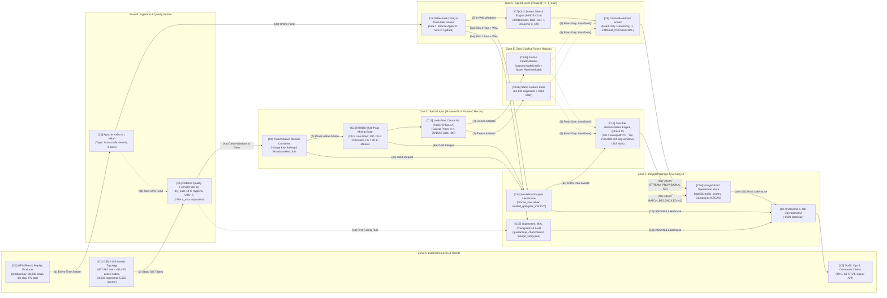

# Thiết Kế Kiến Trúc Hệ Thống Tổng Thể (High-Level & Low-Level System Design — V3)

## 1. Sơ Đồ Kiến Trúc 6 Phân Vùng (`Zones A–F`), 17 Thành Phần (`[C1]`–`[C17]`), 10 Luồng Dữ Liệu (`1`–`10`)

---

## 2. Đặc Tả Toán Học Các Mô-Đun Cốt Lõi (`Low-Level Mathematical Specification`)

1. **Vị nhóm Giao hoán `Commutative Monoid` (`[C9]`, `Pillar I1`):**
   $$\mathbf{m}_{s,w} = (\text{cnt}, \sum v, \min v, \max v, \text{severe\_cnt}), \quad \mathbf{e} = (0, 0.0, +\infty, 0.0, 0)$$
   $$\mathbf{m}_1 \oplus \mathbf{m}_2 = (\text{cnt}_1 + \text{cnt}_2, \textstyle\sum v_1 + \sum v_2, \min(\min v_1, \min v_2), \max(\max v_1, \max v_2), \text{sev}_1 + \text{sev}_2)$$
   Phép chia $\bar{v}_{s,w} = \sum v / \text{cnt}$ và suy diễn nhãn $\text{LOS}_{s,w}$ chỉ được thực hiện duy nhất một lần tại bước `final_aggregate`.
2. **`Directed Line-Graph PageRank` Có Bù Nút Cụt (`[C10]`, `MMDS Ch. 5`):**
   Trên đồ thị chuyển tiếp đoạn đường $L(\mathcal{G}) = (\mathcal{E}, \mathcal{T})$ với $N = |\mathcal{E}| = 84{,}633$, $|\mathcal{T}| = 151{,}929$ và tập nút cụt $\mathcal{D} = \{s \in \mathcal{E} \mid d_{\text{out}}(s) = 0\}$ ($|\mathcal{D}| = 48$):
   $$r_s^{(k+1)} = \frac{1 - \beta}{N} + \beta \left( \sum_{u \in \text{In}(s)} \frac{r_u^{(k)}}{d_{\text{out}}(u)} + \frac{1}{N} \sum_{d \in \mathcal{D}} r_d^{(k)} \right), \quad \beta = 0.85$$
3. **Đặc trưng Nhân quả Mở rộng `Causal Expanding Empirical-Bayes Priors` (`[C11]`, `Pillar I3`):**
   $$\text{Prior}_s(t) = \frac{\sum_{\tau < t} y_{s,\tau} + m_{\text{seg}} \cdot \bar{y}_{\text{global}}(\tau \le t)}{\text{count}_s(\tau < t) + m_{\text{seg}}} \quad (m_{\text{seg}} = 5, \; m_{\text{street}} = 10)$$
   Mọi quan sát có cùng `slot_ts` trên cùng tuyến đường được gom theo nhóm timestamp trước khi tính tổng tích lũy mở rộng (`expanding sum`), đảm bảo bất biến nhân quả tuyệt đối trước mọi nhiễu tương lai tại $\tau > t$.
4. **Kiểm chứng Kế hoạch Thực thi Vật lý `Spark 3.5.7` & `MongoDB 8.0.34` (`[C9]`, `[C14]`, `[C16]`):**
   - `Catalyst Join Plan`: Giảm từ `10 Exchanges` (`SortMergeJoin`) xuống `2 Exchanges` (`BroadcastHashJoin` trên bảng chiều `segments` và `streets`), với `exceptAll() == 0` hai chiều giữa `DataFrame DSL` và `Spark SQL`.
   - `MongoDB 8.0 Compound IXSCAN`: Ghi `33,441` bản ghi qua `4` phân vùng (`69` lô `500` bản ghi `UpdateOne(upsert=True)`), truy vấn `UC-2` sử dụng chỉ mục phức hợp `level_prob_segment_idx` (`{street_level: 1, severe_prob: -1, segment_id: 1}`) với `in_memory_sort = false`, `nReturned = 25`, `totalDocsExamined = 25`, và độ trễ `warm_p95_ms = 0.767 ms < 10 ms`.

