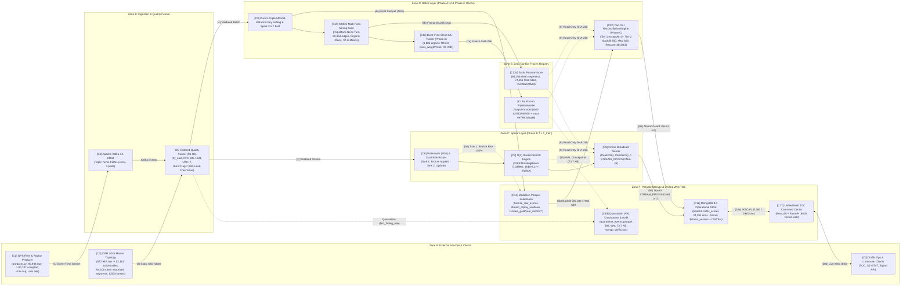

# Thiết Kế Kiến Trúc Hệ Thống Tổng Thể (High-Level & Low-Level System Design)

## 1. Sơ Đồ Kiến Trúc 6 Phân Vùng (`Zones A–F`), 17 Thành Phần (`[C1]`–`[C17]`), 10 Luồng Dữ Liệu (`1`–`10`)

---

## 2. Đặc Tả Toán Học Các Mô-Đun Cốt Lõi (`Low-Level Mathematical Specification`)

1. **Đại số `Pure 5-Tuple Commutative Monoid` (`[C9]`):**
   $$\mathbf{m}_{s,w} = (\text{cnt}, \sum v, \min v, \max v, \text{severe\_cnt}), \quad \mathbf{e} = (0, 0.0, +\infty, -\infty, 0)$$
   $$\mathbf{m}_1 \oplus \mathbf{m}_2 = (\text{cnt}_1 + \text{cnt}_2, \textstyle\sum v_1 + \sum v_2, \min(\min v_1, \min v_2), \max(\max v_1, \max v_2), \text{sev}_1 + \text{sev}_2)$$
   Phép chia $\bar{v}_{s,w} = \sum v / \text{cnt}$ chỉ thực hiện duy nhất một lần ở bước cuối; khớp `100.0%` (`0` sai lệch trên `33,394` cửa sổ) với `baseline.py`.
2. **`Directed Line-Graph PageRank` Loại Bỏ `U-turn` & Bù `Dangling Nodes` (`[C10]`, `MMDS Ch. 5`):**
   Trên đồ thị chuyển tiếp đoạn đường cơ giới sạch $L(\mathcal{G}) = (\mathcal{E}, \mathcal{T})$ với $N = |\mathcal{E}| = 84{,}206$, $|\mathcal{T}| = 92{,}453$ (loại bỏ `dst_e_node == src_s_node` và `src_seg == dst_seg`) và $|\mathcal{D}| = 314$ đoạn cụt:
   $$r_s^{(k+1)} = \frac{1 - \beta}{N} + \beta \left( \sum_{u \in \text{In}(s)} \frac{r_u^{(k)}}{d_{\text{out}}(u)} + \frac{1}{N} \sum_{d \in \mathcal{D}} r_d^{(k)} \right), \quad \beta = 0.85$$
   Top `#1`: `21969 — Nguyễn Kiệm (street_level=2, PR=2.7799)`.
3. **Đặc trưng Nhân quả Mở rộng `Causal Expanding Empirical-Bayes Priors` ($\tau < t$, `[C11]`):**
   $$\text{Prior}_s(t) = \frac{\sum_{\tau < t} y_{s,\tau} + m_{\text{seg}} \cdot \bar{y}_{\text{global}}(\tau < t)}{\text{count}_s(\tau < t) + m_{\text{seg}}} \quad (m_{\text{seg}} = 5, \; m_{\text{street}} = 10)$$
   Chỉ tích lũy trên `TRAIN` hữu cơ (`is_synthetic_burst == 0`) với `max_abs_diff = 0.0` trước nhiễu tương lai.
4. **Kiểm chứng Kế hoạch Thực thi Vật lý `Spark 3.5.7` (`hcmc-traffic-spark:3.5.7`) & `MongoDB 8.0.34` (`[C9]`, `[C14]`, `[C16]`):**
   - `Catalyst Join Plan`: Giảm từ `5 Exchanges` (`SortMergeJoin`, `166.18 ms`) xuống `1 Exchange` (`BroadcastHashJoin` trên `segments` và `streets`, `123.37 ms`, **`25.76%` speedup**), `two_way_exceptAll_diff = 0`; `Monoid 97.92 ms` vs salted `185.78 ms`; Spark MLlib organic TRAIN (`FPGrowth = 32`, `KMeans = 3,609`, `RF = 1,885` đạt `test_acc = 0.9416, roc_auc = 0.9903`).
   - `Spark Structured Streaming`: Sink 2 ghi nhận watermark thực **`2020-12-01T12:30:00.000Z`** (`3` batches committed).
   - `MongoDB 8.0 Compound IXSCAN`: Ghi `33,394` bản ghi qua `4` phân vùng (`69` lô `500` bản ghi) với **atomic `$status_version` pipeline guard** (`25/25` stale `v1` rejected); truy vấn `UC-2` (`1,234` cửa sổ khớp) dùng `level_prob_segment_idx` (`in_memory_sort = false`, `nReturned = 25`, `totalKeysExamined = 26`, `totalDocsExamined = 25`), đạt **`warm_median = 0.360 ms / p95 = 0.603 ms`** so với **`COLLSCAN median = 11.289 ms` (`31.36x`)**.
